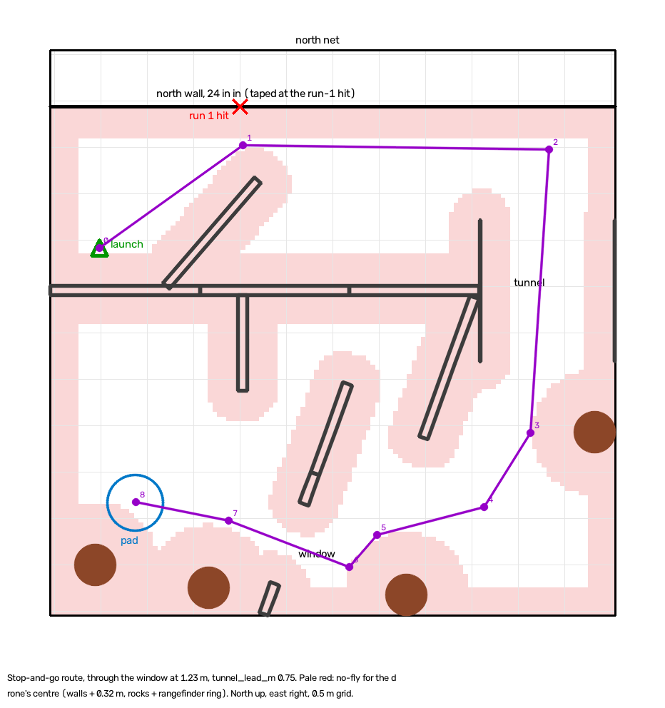
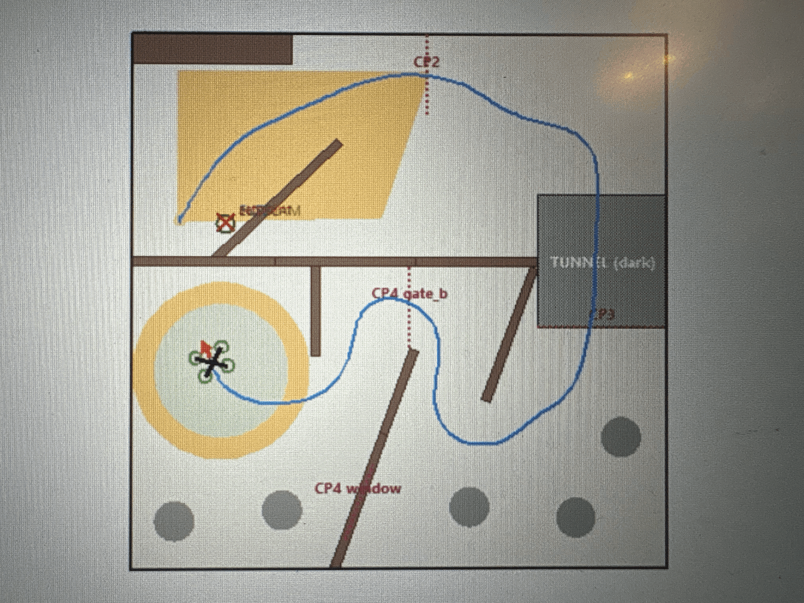

# DroneHacks 2026, Team 08: technical corpus

A single reference for the team's technical presentation (25 pts: autonomy design, technical execution, originality, evidence of testing and iteration) and the generality score (15 pts). It collects what we built, why we built it that way, what each iteration taught us, and the numbers behind every claim.

**Sources.** Everything here was read from the team's GitHub repo on 2026-11-08: every PR (#1–#48), every issue (#3–#45), every branch, the READMEs, `contracts/`, `docs/PRD.md`, `docs/field-guide.html`, `docs/architecture/`, `docs/flight-findings.md` (on `core/flight-iteration`), commit messages, and the recorded flight folders; §24–§25 add the team's `Drone 11 Flight Stack` explainer (8 Nov morning) and `navigation/pp-path-flight` (`872731c`). Where a number comes from simulation, the bench or a real flight, the text says which. **Judges will ask, and "evidence of testing" is a named criterion.**

**Workstreams** (by package and PR):

| Workstream | What it covers |
|---|---|
| Process and contracts | Board and merge infrastructure, contracts (#5), PRD (#16), STEP→map generator (#22), `core/` navigation math (#28), architecture diagrams (#44) |
| Trajectory stack and platform | Rules reference and course CAD (#4), drone snapshot and Acro ban (#14), `planner/` trajectory library (#24), `nav_traj/` mission stack (#26), lidar stack (#27), SITL simulator (#39), new course layout (#42), drone-11 switch (#43), DH Bailout firmware (#46, #47), `navigation/new-course-layout` |
| Course follower and research | Pre-event PX4/Gazebo SITL research (the DroneDepthCamTesting repo, source of most field-guide findings and the lidar stack), `dronehacks_telemetry` flight recorder, `dronehacks_course_follower` (stop-and-go and smooth), `docs/flight-findings.md`, yaw compensation, firm touchdown, the return home |
| Map-driven packages | Manual map-derived waypoint navigator (#33), `dronehacks_autonomy` generic map-driven package (#38) with the generality test suite, the dropout coast port and its safety fixes |
| Primitives and flight data | `dronehacks_square_test` (the first autonomous flights), skybeta-11 flight data, `COM_DISARM_LAND` contract (#40), repo layout (#41) |

---

## Contents

1. [The problem in one page](#1-the-problem-in-one-page)
2. [ROS 2 from first principles: what we actually build](#2-ros-2-from-first-principles-what-we-actually-build)
3. [Timeline of iterations](#3-timeline-of-iterations)
4. [Iteration 0: the night-1 conceptual model (papers, PRD, contracts)](#4-iteration-0-the-night-1-conceptual-model)
5. [Iteration 1: making the drone fly at all](#5-iteration-1-making-the-drone-fly-at-all)
6. [Iteration 2: the primitives ladder (square test)](#6-iteration-2-the-primitives-ladder-square-test)
7. [Design principle: layered abstraction](#7-design-principle-layered-abstraction)
8. [Course planning: the shared foundation](#8-course-planning-the-shared-foundation)
9. [The course follower: buffer zones and straight legs](#9-the-course-follower-buffer-zones-and-straight-legs)
10. [The trajectory stack: the smooth, time-optimal path](#10-the-trajectory-stack-the-smooth-time-optimal-path)
11. [The planner family: seven designs side by side](#11-the-planner-family-seven-designs-side-by-side)
12. [Generality: one map file away from a new course](#12-generality-one-map-file-away-from-a-new-course)
13. [Localization research: the Guard, lidar fusion, cuVSLAM](#13-localization-research-the-guard-lidar-fusion-cuvslam)
14. [Our own software-in-the-loop simulator](#14-our-own-software-in-the-loop-simulator)
15. [Telemetry: the flight recorder and analysis](#15-telemetry-the-flight-recorder-and-analysis)
16. [DH Bailout: our own PX4 flight mode](#16-dh-bailout-our-own-px4-flight-mode)
17. [Safety engineering and contracts](#17-safety-engineering-and-contracts)
18. [How we engineered: an agent-coordinated, review-gated repo](#18-how-we-engineered-an-agent-coordinated-review-gated-repo)
19. [What reality taught us (lessons list)](#19-what-reality-taught-us)
20. [Numbers cheat sheet](#20-numbers-cheat-sheet)
21. [Honest caveats and open items](#21-honest-caveats-and-open-items)
22. [Glossary](#22-glossary)
23. [Credits](#23-credits)
24. [The drone 11 flight stack as pitched, and the 8 Nov judging](#24-the-drone-11-flight-stack-as-pitched-and-the-8-nov-judging)
25. [`dronehacks_pathfly`: flying an offline-planned route by twist](#25-dronehacks_pathfly-flying-an-offline-planned-route-by-twist)

---

## 1. The problem in one page

**Task.** Program an issued quadcopter (the "Sky Beta") to fly an indoor course on its own after one start command: no GPS, no pilot input. The course goes first corridor → maze → dark tunnel → chicane (window or Gate B) → land and disarm on a pad. There is an optional return over the barrier to the launch mark (×1.25 run points). 3-minute limit, +5 s per touch.

**Scoring.**
- Run: 60 points. An unfinished run gets checkpoint points plus up to 7 × (fastest time ÷ ours). A finished run gets 35 + 20 × (fastest ÷ ours) + 5 through the window.
- Judged: 40 points. Presentation 25, generality 15.
- **Every finished run beats every unfinished run.** That one line decides the strategy: finish first, then go faster.

**The hardware.**
- 7-inch carbon quad, about 1.25 kg, props reach **0.28 m** from the centre, footprint 0.37 × 0.48 m.
- Jetson Orin Nano 8 GB running ROS 2 Humble.
- Pixhawk 6C running PX4 (v1.16.2-1-g7a39c59 on our drone 11).
- OAK-D S2 stereo camera (2 × 1 MP global shutter, 75 mm baseline, 30 fps, IMU 200 Hz), forward-facing.
- VL53L1X downward time-of-flight rangefinder (≤ 4 m, 27° cone).

**The kit's software.**
- `depthai-ros` camera driver.
- NVIDIA Isaac ROS cuVSLAM, stereo-only visual odometry.
- `px4_odom_bridge.py`, which feeds vision to PX4's EKF2.
- `skybeta_flight_interface`, the only thing allowed to write to PX4.

**The course, as published.**
- 6.096 m square net, 3.048 m tall.
- Walls 1.727 m tall and 0.102 m thick.
- Corridors 1.02–1.07 m wide (narrowest 0.93 m). With 0.28 m prop reach, that leaves **±0.18 m for all error**.
- Oval tunnel 58 × 72 × 60 in, dark inside.
- Window 0.914 m square. Published at 0.305–1.219 m up; tape-measured on 2026-11-08 at 0.914–1.549 m up.
- Five boulders, 0.457 m across.
- Pad 1.524 m across.

**The layout changed on 2026-11-07.**
- Maze dividers M1–M3 were removed.
- A diagonal wall and a north-west block were added.
- Checkpoint 1 was removed; CP2–CP5 are worth 31 points.
- On 2026-11-08 the team taped an inner north wall 0.61 m inside the north net.

---

## 2. ROS 2 from first principles: what we actually build

The whole project is one idea: **subscribe to messages that describe the world, run our own logic on them, and publish our own messages that command the drone.** Everything else is plumbing, safety and evidence.

### 2.1 The vocabulary

| Term | What it is | In our stack |
|---|---|---|
| **Node** | A process (here, Python) that does one job | `square_test`, `course_follower`, `mission` |
| **Topic** | A named channel, like `/skybeta/setpoint/pose` | Nodes publish to it and subscribe to it |
| **Message** | A typed data structure sent on a topic | `nav_msgs/Odometry` (pose + velocity + covariance), `geometry_msgs/PoseStamped`, `geometry_msgs/TwistStamped`, `std_msgs/String` |
| **Publisher / subscriber** | The two ends of a topic | `create_publisher(PoseStamped, '/skybeta/setpoint/pose', 10)` |
| **Timer** | A callback run at a fixed rate | Our control loops tick at 20–50 Hz |
| **QoS** | Delivery policy (reliable or best-effort, history depth, durability) | PX4's `/fmu/out/*` is best-effort; a default (reliable) subscriber **silently receives nothing** |
| **Parameter** | A typed per-node setting, set at launch | `side_m`, `height_m`, `speed_mps`. Humble refuses an int for a float parameter, so our nodes declare `dynamic_typing=True` |
| **Launch file** | Python that starts nodes with their parameters | `square_test.launch.py`, `competitor.launch.py` |
| **Package** | The unit `colcon` builds (`package.xml` + `setup.py`) | Everything under `team_ws/src/` |
| **DDS domain** | Network partition; `ROS_DOMAIN_ID` must match PX4's `UXRCE_DDS_DOM_ID` | 11 on skybeta-11 |
| **uXRCE-DDS** | The bridge that turns PX4's internal uORB topics into ROS topics (`/fmu/out/*`, `/fmu/in/*`) | Runs over the Pixhawk's TELEM2 serial link |

### 2.2 The data flow on the drone

```
                 SENSE                        THINK (ours)                       ACT
OAK-D S2 ─► depthai-ros ─► cuVSLAM ──/visual_slam/tracking/odometry──┐
  stereo 30 fps + IMU      (stereo VO)     nav_msgs/Odometry, ~30 Hz  │
                              │                                       ▼
                              └─► px4_odom_bridge ─► PX4 EKF2   ┌──────────────┐
                                  (ENU/FLU→NED/FRD)  (fuses IMU,│ our mission  │──/skybeta/setpoint/pose──┐
                                                     vision, ToF)│  node        │──/skybeta/setpoint/twist─┤
/skybeta/state (JSON: armed, offboard_active, landed, ──────────►│ (plan, state │                          ▼
   local_enu, odom_enu, setpoint_mode, clamped...)               │  machine,    │      skybeta_flight_interface
/fmu/out/* (read-only: attitude, land detector, accel) ────────►│  safety)     │      (clamps, ENU→NED, 10 Hz,
course map file (YAML/JSON) ───────────────────────────────────►└──────────────┘       auto-Offboard)
                                                                                              │ /fmu/in/* (kit only)
                                                                                              ▼
                                                                                       PX4 Offboard → motors
```

**Our nodes own exactly one thing: the setpoint stream.** We never arm, never change mode, never write `/fmu/in/*` and never change PX4 parameters from code. This is both the organisers' rule and contract invariant §3.8.

### 2.3 The handshake that starts autonomy

1. The pilot arms in **Altitude**, then switches to **Position**.
2. With `auto_offboard_on_arm: true`, the interface requests Offboard **once per arming**, and only if a team setpoint is **under 1 s old**.
3. So our node must already be streaming a valid setpoint before the switch. Every mission we wrote therefore has a WAIT state that streams a pose over the drone at flight height, but **only while its pre-checks pass**. If a check fails it sends nothing, Offboard is refused, and PX4 auto-disarms after `COM_DISARM_PRFLT` (10 s).
4. From then on, the node reads `/skybeta/state.offboard_active`. If the pilot takes over, autonomy is off until the next disarm and arm.

### 2.4 The interface's rules we design around

| Rule | Consequence |
|---|---|
| Resends the latest pose at `setpoint_rate_hz` (10 Hz default) | A 50 Hz led-pose design gets each pose held for 100 ms. Plain poses became the default |
| Pose z is clamped to 0.3–3.0 m | A pose can never reach the floor, so **landing must be a downward twist** |
| A twist expires after `setpoint_timeout_s` (1 s) into the last pose | If a descent twist stops, the drone climbs back to the stored pose. So landing logic must keep publishing even with stale odometry |
| Twist speed clamped to `max_speed_mps` (1.5 m/s default) | The window-at-2 m/s line raises this launch argument |
| An all-zero quaternion means "yaw not commanded" | Used in WAIT and climb |
| `anchor_setpoints: false` (default) | Odom ENU goes to PX4 NED **unanchored**: the root cause of the doubled-height flight (§6.3) |

### 2.5 Frames (a 90° mistake flies into a wall)

| Frame | Convention |
|---|---|
| Course | x east, y north, origin at the floor centre (the map) |
| cuVSLAM `odom` | ENU-labelled, **origin wherever the stack started**, x = the nose at start-up |
| ROS `base_link` | FLU (forward, left, up) |
| PX4 local | NED (north, east, down) with EKF2's own origin |
| PX4 body | FRD |

- ENU → NED is `(x, y, z) → (y, x, −z)`.
- FLU → FRD is `(x, −y, −z)`.
- Course → odom (from `contracts/frames.md`): `p_odom = o_odom + R(yaw)·(p_course − o_course)`.

**Height is the trap.** PX4 takes height from the rangefinder (`EKF2_HGT_REF=2`) and horizontal position plus yaw from vision (`EKF2_EV_CTRL=9`). So PX4's z origin and cuVSLAM's z origin are different. See §6.3.

---

## 3. Timeline of iterations

All times Pacific; flight folder names are UTC.

| When | Iteration | What happened |
|---|---|---|
| Fri 11-06, evening | **0. Conceptual model** | Rules extracted (#4), field guide, four contracts (#5), drone snapshot and Acro ban (#14), PRD with MonoRace/SkyDreamer analysis (#16), agent board and review infrastructure (#1, #15, #31) |
| Fri night → Sat morning | **0b. Parallel designs** | STEP CAD→map (#22), `planner/` trajectory library (#24), `nav_traj` mission (#26), lidar stack (#27), `core/` navigation math (#28), manual waypoint navigator (#33). All merged by Sat ~07:00 UTC |
| Sat 11-07 | **1. Make it fly** | First drone flipped on take-off (a firmware flash had overwritten the motor configuration). Offboard bug in kit 0.3.2 (wrong MAVLink system ID). Switched to **drone 11** (#43) |
| Sat daytime | **Tooling** | SITL simulator (#39), map-driven `dronehacks_autonomy` with generality suite (#38), flight recorder (`telemetry/flight-recorder`) |
| Sat 15:21 | **1b. Bench check** | `20261107-232125-light-bench-check` |
| Sat 15:27–16:30 | **2a. Up/down, first square attempts** | `232746`, `233451`, `002220`, `003042`. The last one is the **doubled-height** flight: PX4 z −0.72 m on the floor |
| Sat ~16:30 | **Fix** | Power-cycle on the mark, plus PX4-offset tracking in every setpoint (`5c772d8`, `f0daafc`) |
| Sat 17:30 | **2b. First complete box** | `013018`: 0.5 m box, four turns, landed. Corner drift after each yaw discovered; touch-and-go failed (PX4 auto-disarm at 1.9 s) |
| Sat evening | **Fixes** | `COM_DISARM_LAND` 5 s approved by organisers (#40), climb at once on landed, hold tolerance 20 cm / 10°, airframe-push analysis, yaw_comp, firm touchdown |
| Sat 19:44–19:55 | **2c. Full primitive sequence** | `034442` (never lifted), `034923` (square + landing, disarmed at relaunch), **`035510`: square, ground rest, relaunch, 1 m circle, landing, disarm** |
| Sat evening | **New layout** | CAD re-export and contract (#42); the course follower's tape-measured map; the trajectory stack's `new-course-layout` |
| Sat night | **Firmware** | DH Bailout PX4 flight mode built and SITL-tested (#46); flashed onto skybeta-11 (#47) |
| Sun 00:13, 00:21 | **3. Whole course, stop-and-go** | Course follower at ladder step 0 (0.3 m/s): `081345` (crashed mid-route, pilot killed), `082135` (climbed to 0.80 m and flew the route) |
| Sun early morning | **Map and route fixes from those runs** | North wall where run 1 hit; turn only once the drone reaches the waypoint; rocks and pad re-placed by tape |
| Sun | **Smooth line ready** | The trajectory stack's window line at 2 m/s (30.9–33.7 s SITL) and 0.5 m/s test line |
| Sun morning | **First scored session** | Every flight ended when a stick moved (stick override); a north-wall crash came after pilot input at 66.2 s, with the drone 3–8 cm from its setpoint until then; a tracker jump after a manual landing. → Route moved 0.61 m off the north wall, LOST phase, hands-off procedure (§24.2) |
| Sun morning | **Second route package** | `dronehacks_pathfly` (`navigation/pp-path-flight`): offline footprint-exact plan flown by twist, nose east (§25) |

---

## 4. Iteration 0: the night-1 conceptual model

### 4.1 Research synthesis: MonoRace and SkyDreamer

**What they are.** Two state-of-the-art autonomous drone-racing systems that use learned, end-to-end **neural motor policies**: the network outputs the four motor commands u₁…u₄ directly. They fly 6–7 g manoeuvres at 75–100 km/h.
- **MonoRace** runs its guidance-and-control network (G&CNet) at **500 Hz on the STM32H743** flight microcontroller itself.
- **SkyDreamer** runs at **90 Hz on a Jetson**, with a **2000 Hz gyro** stream and **bidirectional DShot motor-RPM feedback** (ω₁…ω₄).

**Why we rejected direct-to-motor control for the Sky Beta** (PRD §0.1). This is a deliberate, evidence-based "no", and judges value that.
1. **Rules and interface.** The kit says "do not publish to `/fmu/in/*`"; rule 8.5 forbids touching PX4 safety settings. Raw `ActuatorMotors` would bypass PX4's attitude and rate loops and break the `COM_OF_LOSS_T` (1 s) Offboard-loss fallback.
2. **Latency and rate mismatch.** Our stereo runs at 30 fps and the IMU at 200 Hz. Commands cross a uXRCE-DDS link with **68.7 ms median latency**, and there is no RPM feedback. Stabilising motor thrust over a ~69 ms delayed loop with no RPM sensing oscillates.
3. **The speed cap makes it pointless.** At the then-assumed `MPC_XY_VEL_MAX` = 1.0 m/s, drag and rotor-wash non-linearities that learned policies exploit are negligible.
4. **Tracking through the supplied interface** is the supported path.

**What we did adapt from the papers and VIO practice** (PRD §0.2 and the architecture timeline):

| Technique | Origin | What we did | Status / result |
|---|---|---|---|
| **Look-ahead gaze** | Active perception | Nose points at the path 0.80 m ahead, so the camera rotates into the next corridor before a corner | Built (#28, and in every follower). In simulation, facing a wall at 0.3 m withheld **390 of 543 frames** |
| **Health gating (the Guard)** | VIO health states (HEALTHY / DEGRADED / LOST), MonoRace's innovation gating | `vo_guard` withholds stale, failed, jumping (>10 m/s), spinning (>720°/s) or gyro-disagreeing (>3° in 0.5 s) poses | Built (#27). Frame-break test: worst point **12.2 mm** off path, versus **203 mm** without the realign hold |
| **Map anchoring** | GateNet-style PnP, AlphaPilot gate-offset estimation | Instead of segmenting gates: match a 2D lidar scan (or a stereo-depth slice) to the CAD walls (ICP / Gauss-Newton), estimate the drift transform | Built (#27). **0.6 cm rms** against PX4 on the bench |
| **State-based ROI / frustum culling** | MonoRace | Drop depth points outside the 6.1 m net so the room behind the see-through net never corrupts matching | Proposed |
| **Covariance from feature count** (σ² ∝ 1/N²) | MonoRace | Inflate vision variance when texture is low | Proposed; blocked (EKF2 semantics unverified) |
| **Re-anchoring on recovery** | VIO practice | On LOST → HEALTHY, recompute the anchor so the new vision pose equals PX4's dead-reckoned pose | Proposed. Withholding without it gave a **2.2 m jump** (149 cm rms) in simulation; with it, 24.5 cm |
| **Direct-to-motor policy** | MonoRace, SkyDreamer | — | **Rejected** (above) |

### 4.2 The four-lane architecture (field guide)

1. **Where am I** (every camera frame): OAK-D → depthai-ros → cuVSLAM → *(Guard)* → bridge → EKF2.
2. **Stay on the walls** (stretch): stereo depth or lidar → map correction.
3. **Height**: VL53L1X → EKF2 height reference.
4. **Where to go**: course map → Planner (A* + Nav2 cost) → Follower (smooth path, speed profile, look-ahead) → flight interface → PX4 Offboard.

Strategy in six lines:
1. Finish first; corners set the time, not top speed.
2. Use the kit's software where it costs nothing.
3. Add our code only where simulation measured a failure.
4. Plan from the map, never hand-drawn waypoints.
5. Survey the real course to about 5 cm.
6. Never touch the organisers' PX4 safety settings.

### 4.3 Pre-event simulator findings that shaped the design

These came from the team's pre-event PX4 v1.16.1 + Gazebo SITL, flying a stand-in x500 with simulated OAK-D and cuVSLAM in the loop.

| Finding | Evidence | Design consequence |
|---|---|---|
| cuVSLAM is confidently wrong on a blank view and never reports the loss | Camera blinded on a moving leg: crash | The Guard |
| Stereo-only beats cuVSLAM's inertial mode in flight | Inertial mode's in-flight IMU initialisation broke tracking once per run; stereo 5 of 5 clean | Stereo-only; EKF2 does the inertial fusion |
| Latency is the biggest cost; noise and blur cost nothing | +50 ms roughly doubled the error | Cut latency first |
| Their `EKF2_EV_DELAY` 70 ms double-counts latency | The bridge already stamps at capture; 70 ms touched 4 of 5 | Keep 0, confirm from logs |
| A course laid 10 cm off its file breaks every run | 5 of 5 touched at 10 cm; about baseline at ≤ 5 cm | Survey to 5 cm (we did, by tape, on 11-08) |
| Top speed doesn't set the time; corners do | 1.0 / 1.5 / 2.0 m/s all took 27–31 s | Optimise cornering, not v_max |
| Facing a wall up close starves the tracker | 390/543 frames withheld at 0.3 m | Look-ahead gaze |
| The first maze corner is the weak spot | Most touches; PX4 1.16's attitude overshoot | Slow there |
| A cross-track push in the follower made it worse | 20 layouts: 1 touch without, 4 with | Rejected |
| A live map never beat the course file; AMCL was worse than PX4's estimate | AMCL 7.9–56.3 cm rms vs PX4 2.2–19.3 | Plan on the file |
| A 2D lidar localised as well as stereo, no better | 3.1–6.1 cm vs 3.5–5.7 cm; a spinning head's smear doubled error until deskewed | No added sensor unless the tunnel blinds the camera |
| Planned route vs hand route | As clear, **1.5 s faster**, re-planned **20 of 20** layouts with moved boulders where the hand route failed 14 | Map-driven planning (generality) |
| Recommended configuration over 15 layouts | Tunnel blinded: 12 of 14 cleared, 2.4–7.6 cm rms, launch to pad **27–34 s**; with +50 ms latency 19 of 20 | The target design |

The organisers' own FlyX lab (2026-11-07) showed:
- **Localization held**: PX4 within 2–6 cm of truth.
- **Their reference mission's step setpoints overshot each leg by 38–60 cm** and swung the heading ±40°.
- It then turned in place facing a wall, cuVSLAM failed, and the landing failsafe ended the run.

Lesson: smooth, rate-limited setpoints, not steps, and never turn in place facing a wall.

### 4.4 Contracts: the repo's source of truth (#5)

Four normative files, each row tagged `organisers` / `surveyed` / `measured` / `inferred` / `team`:
- **`frames.md`**: the frame table, ENU/NED maps, the course→odom transform and its bench carry test.
- **`course.md`**: geometry, checkpoints, the derived ±0.18 m error budget, the map-file schema, a layout-tolerance rule, and a fail-closed `window.clearance_radius` with **no default substitution**.
- **`px4.md`**: the **writable-parameter allowlist** (everything else is the organisers'), the failsafe table, version and transport pins, and the `/fmu/in/*` prohibition.
- **`ros-graph.md`**: the node table, Guard withhold conditions, the planner's map-only-goals rule, follower constraints and the QoS traps.

**Invariant 1: "contracts beat code."** Changing a contract needs a PR, a `CHANGELOG.md` entry and a ping to owners. A CI guard (`check_contracts.py`) refuses contract edits without a changelog entry.

### 4.5 Rules reference and drone snapshot

- **`DRONEHACKS.md` (#4)** summarises all 65 rules by topic, with source fingerprints. The course STEP AP214 CAD is committed.
- **`drone-snapshot/` (#14)** is the Jetson's preloaded code: organiser stack skybeta v0.3.2, an empty `team_ws`, and `drone.env`. It was secret-scanned, PulseAudio cookies were excluded, and a Tailscale IP was redacted. It became our ground truth for the interface's real behaviour (we read `flight_interface.py` and `auto_offboard.py` instead of guessing).
- **Project invariant §3.6: no Acro mode**, in any code, launch file or mode mapping.

---

## 5. Iteration 1: making the drone fly at all

Before any of our code could matter, the drone had to take off. Three blockers, all found and fixed on the day.

### 5.1 The flipping drone: motor configuration overwritten

**Symptom.** The first drone flipped on take-off.

**Root cause.** A firmware flash had **overwritten the motor configuration**: motor order and spin direction no longer matched the airframe's real motors, so PX4's mixer drove the wrong motors for a given correction. A quad whose control allocation is wrong flips the instant it spools up.

**Fix.** Motor reconfiguration, done once per drone. The organisers do it on request.

**Our contribution.** We were the team that identified this and got it fixed. It went into `docs/flight-findings.md` "Before arming" as a standing check: *motor order and direction, props off, on every drone swapped in.*

Why it matters technically: PX4 maps desired body torques to motors through its control allocation (`CA_ROTOR*` geometry and the motor-output mapping). Our SITL models rotor geometry from those same `CA_ROTOR*` parameters.

### 5.2 Offboard never engaged on non-drone-1 FCs (kit 0.3.2 bug)

- The 0.3.2 interface sent `DO_SET_MODE` to MAVLink **system 1**.
- But each fleet FC's `MAV_SYS_ID` is its drone number, so PX4 dropped the command. **No drone but drone 1 could enter Offboard.**
- Fixed upstream in skybeta 0.3.3: `target_system` 0 means "the FC's own ID".
- Check: `cat ~/skybeta/VERSION`. After arm-then-Position, `docker logs skybeta-stack | grep -i offboard` must not say "did not enter Offboard within 2 s".
- We verified our `team_ws` launch files never override `target_system`.

### 5.3 Mode-switch mapping (found in our SITL)

Drone 1's 2026-10-15 parameter dump has `COM_FLTMODE6 = 0`, so the switch position the pilot calls "Position" was actually **Manual**, and arm-then-Position would never start Offboard. The fleet baseline has 2. This was SITL finding 1, found before anyone flew.

### 5.4 Switching to drone 11 (#43)

The team moved to **skybeta-11**. We re-read its FC over USB: HEARTBEAT, `AUTOPILOT_VERSION`, `ver all`, and two full parameter passes that agreed bit for bit. The baseline was saved as `contracts/px4-baselines/skybeta-11-2026-11-07.params`.

Differences that matter:
- **`MPC_XY_VEL_MAX` is 12, not 1.0.** The FC no longer caps speed; our own code's caps are the only ones.
- **`NAV_RCL_ACT` is 2, not 6.** RC loss requests Return, which falls back to Land or Descend without GPS.
- `MPC_TILTMAX_AIR` is 45.
- DDS domain 11.
- Firmware `v1.16.2-1-g7a39c59`.

**Disqualification guard.** AGENTS.md now says never SSH into any drone but ours, and the lidar installer refuses any host but `skybeta-11`.

### 5.5 Arming procedure (organiser announcement, encoded everywhere)

1. Restart the stack with the drone **on the launch mark**: `docker rm -f skybeta-stack`. cuVSLAM's origin is wherever the stack started.
2. Arm in Altitude.
3. Switch to Position.

---

## 6. Iteration 2: the primitives ladder (square test)

**Idea.** Don't attempt the course until each primitive is proven on the real drone: hold height → move a known distance → turn → land → disarm → relaunch → curve. Each flight adds one primitive. Each failure is diagnosed from recorded data and fixed in code, not by guessing.

**Package:** `team_ws/src/dronehacks_square_test/` (branch `core/square-test`; also merged into `core/flight-iteration`).

### 6.1 The ladder as flown on skybeta-11

| Flight (UTC) | Primitive | Outcome | What we learned and fixed |
|---|---|---|---|
| `20261107-232125` bench-check | Recorder and stack bring-up | Recorded | The recording pipeline works on the drone |
| `232746`, `233451`, `002220` | Climb, hover, first box attempts | Early runs | Bring-up of arm → Offboard → climb |
| `003042` | Climb to 0.73 m | **Flew to ~1.33 m.** The hold never passed, and the 20 s step timeout landed it | PX4 local z read **−0.72 m on the floor** vs odom 0.01 m. → Power-cycle on the mark, then **PX4-offset tracking** (§6.3) |
| `013018` | **First complete 0.5 m box** with four 90° turns and landing | Held 0.71–0.75 m for a 0.73 m target. Holds took 7–15 s vs 3–7.5 s planned | **Drift after every yaw** (§6.4). **Touch-and-go failed**: PX4 disarmed 1.9 s after landing, 0.8 s into the climb (§6.5) |
| `034442` | Full sequence v2 | PX4 disarmed 18 s into the first climb (never lifted off) | Kept as data |
| `034923` | Square + first landing | Done; PX4 disarmed as the second climb began | Landing works; relaunch timing still tight |
| **`035510`** | **Square → land → 2 s ground rest → relaunch → 1 m circle → land → disarm** | **Full sequence, disarmed on the ground at 107 s** | The whole primitive set proven. The landing-detector delay (~4 s on the floor before low-throttle) led to the firm touchdown (§6.6) |

### 6.2 The mission as a discrete state machine (`mission.py`, no ROS)

`plan()` builds a list of steps from the config:
- **climb**;
- **box**: four moves of `side_m`, each followed by a hold that yaws +90° at `yaw_rate_dps`;
- **land**;
- **rest** on the ground;
- **climb**;
- **move** to the circle start;
- **circle** (diameter `circle_d_m`, anticlockwise);
- **return** and hold;
- **land**;
- **disarm**.

`step()` is called at 20 Hz with (time, pose, pose time, offboard, landed, armed, yaw, PX4 position) and returns one command: pose, twist or nothing.

Always-on rules:
- **WAIT** refuses to stream if PX4 and the camera disagree by more than `max_offset_m` (0.3 m), so Offboard never starts on a bad frame.
- **Pilot takeover**: Offboard ends → STOPPED for good.
- **Any disarm** ends the mission.
- **Stale pose**: hold still, then straight down after 3 s.
- **Step timeout** (20 s, later 30 s): land where it is.
- **Landing**: a twist at −0.3 m/s with an XY pull back over the start, then a gentle press once PX4 reports landed, until disarm.

**Holds.** A hold's timer starts once the drone is within 20 cm and 10° (it was 10 cm; flight `013018` showed 15–20 cm of post-yaw drift waiting out the 10 cm check).

### 6.3 Root cause #1: two height origins (the "doubled height")

- PX4 takes height from the rangefinder, with its origin where the FC powered up. cuVSLAM's origin is where the stack started.
- `anchor_setpoints: false` means the interface sends odom z straight to PX4 as NED z.
- In `003042` PX4 read **−0.72 m on the floor**, so a 0.74 m odom target became ~1.33 m real.
- The arrival check (in the camera frame, 10 cm) never passed, the 20 s timeout fired, and it landed via the timeout path.

**Fix (`5c772d8`, `f0daafc`).** Every setpoint carries the PX4-minus-camera offset, computed from `/skybeta/state.local_enu` minus odometry.
- At first the offset was frozen at Offboard.
- Then it was **smoothed over 1 s throughout the flight** (`offset_tau_s`), because the rangefinder reads wrong on the floor and right in the air. A frozen offset would have flown ~14 cm high.
- If the offset is over 0.3 m at rest, the node streams nothing, so Offboard never starts. The log tells the operator to power-cycle.
- Result in `013018`: offset 0.13 m on the floor, 0.20–0.23 m in the air, height held 0.71–0.75 m for 0.73 m.

### 6.4 Root cause #2: a push fixed to the airframe (drift after yaw)

**Analysis** (from the `013018` bags):
- PX4's estimate and odom agree (median 1.3 cm, 95th percentile 3.3 cm, heading 0.6°), and PX4 receives the right target. So this is **control error, not estimation error**.
- A hold without a yaw stays within ~7 cm. After each 90° yaw at 20°/s, the error peaks at **10–18 cm, 1–3 s after the yaw**, always to the left of the new nose, and takes up to 8 s to recover.
- **Model:** there is an unmodelled acceleration of about **0.10 m/s²** (≈0.6° of tilt), forward-left, **fixed in the body frame**. In `003042` it was 0.25 m/s². PX4's velocity integrator learns to cancel it **in world axes**. After a yaw of Δψ, the learned correction points the old way. The unlearned part is `2·sin(Δψ/2)·push`, and rotating the push by each yaw predicts every corner's drift direction within 9–18°.
- Likely physical cause: a thrust axis tilted ~1° from the IMU, or an unlearned accelerometer bias. The ULog's `estimator_sensor_bias` tells them apart.
- Impact: 10–18 cm per 90° at 0.10 m/s², or 25–35 cm at 0.25, **against a ±0.18 m maze budget**.

**Three fixes, none touching PX4:**
1. **`heading_mode: fixed`**: never yaw. The camera faces the launch heading the whole way.
2. **Slow yaws plus a settle** before moving (stop-and-go's holds).
3. **`yaw_comp.py` feed-forward**, off by default and not yet flown:
   - Measure the push from PX4's accelerometer (`/fmu/out/sensor_combined`, FRD) in 2.5 s of steady hover.
   - Model PX4's integrator as a first-order lag with τ = `MPC_XY_VEL_P_ACC` / `MPC_XY_VEL_I_ACC` ≈ 4.5 s at stock gains.
   - Add `−(R(ψ)·d − L) / gain` to every pose setpoint, where gain = `MPC_XY_P` × `MPC_XY_VEL_P_ACC` = 1.71, capped at 0.20 m.
   - Fitted on replays of the two flights.

### 6.5 Root cause #3: PX4 auto-disarm vs touch-and-go

- PX4 disarms `COM_DISARM_LAND` seconds (2 s, organiser default) after it reports landed, and a disarm ends Offboard for good.
- In `013018` the climb started 1.1 s after landed and disarm hit at 1.9 s, 0.8 s into the climb.
- Iterations:
  1. Climb the instant PX4 reports landed (`de836fb`).
  2. Replace the ground rest with an 8 cm low hover (`4688c42`).
  3. **Contract change (#40): organisers approved `COM_DISARM_LAND` = 5 s on skybeta-11**, set by hand in QGC, the first allowlist exception. Then a real 2 s ground rest with about 3 s left for lift-off (`883b2af`).
- This is what makes the **return-home bonus** physically possible.

### 6.6 Root cause #4: why landing detection is slow (firm touchdown)

From the PX4 v1.16 source (`MulticopterLandDetector`):
- **Ground contact** needs the thrust setpoint at or under `MPC_THR_MIN + 0.6·(hover − MPC_THR_MIN)`, and a **commanded descent of at least 1.1 × `LNDMC_Z_VEL_MAX`** = 0.275 m/s at 0.25.
- After that it is fixed hysteresis: ground_contact → maybe_landed → landed, about 1 s apart.

On the floor, only the vertical velocity loop lowers thrust: `MPC_Z_VEL_P_ACC` (4) × error, plus the `MPC_Z_VEL_I_ACC` (2) integrator. In `035510` (0.3 m/s twist) the drone sat on the floor **~4 s before low throttle**.

**Fix (`d25213f`).** Once the odometry height has held 0.3 s near the floor, command **1.0 m/s down**. A 1 m/s error × 4 asks for 4 m/s² down at once.
- SITL: touchdown → landed went from 4.20 s to 3.58 s.
- No PX4 parameter changed.
- Also: a descent slower than 0.275 m/s defeats the "commanded down" test. In our SITL it took 33 s to disarm at 0.2 m/s, against 3 s at 0.3.

---

## 7. Design principle: layered abstraction

Every flight package we wrote uses the same four layers. It's the reason the logic is testable on a laptop, simulatable in our SITL, and portable between maps.

| Layer | File(s) | Knows about | Never touches |
|---|---|---|---|
| **1. Pure logic** | `mission.py` (state machine), `planner.py` / `route.py` / `smoothing.py` / `speed.py`, `follower.py`, `stop_and_go.py`, `frames.py`, `yaw_comp.py` | Numbers in, command out: `step(now, pose, offboard, landed, armed, px4) → Command` | ROS, rclpy, topics, files |
| **2. ROS node wrapper** | `square_test_node.py`, `node.py`, `mission_node.py` | Subscriptions, publishers, parameters, timers, QoS, message conversion (quaternion ↔ yaw), recording | Decision logic |
| **3. Launch** | `*.launch.py` | Starts the kit's `flight_interface` with the right arguments, plus our node; picks maps and config | Flight logic |
| **4. Packaging and deploy** | `package.xml`, `setup.py`, `drone.env`'s `COMPETITOR_PKG`/`COMPETITOR_LAUNCH`, `install_on_drone.sh` | How `team_build.sh` (`colcon build --symlink-install` over all of `team_ws/src`) and `run_competitor.sh` find and start us | — |

**Why it pays off:**
- **Tests without ROS.** `test_mission.py` drives `Mission.step()` against a crude drone model: the turns, a ground wait longer than `COM_DISARM_LAND`, pilot takeover, a stale pose, the PX4 offset. Counts across suites: planner/course 119, team_ws 241, depthcam 311, sitl 80, merge gate 51.
- **The SITL runs the real code unmodified.** It runs exactly layers 2–4 under emulated ROS.
- **The dry run** (`python -m …dry_run`) flies layer 1 against a stand-in PX4 and prints the route, the timings and the touches before any flight.
- **Swapping the follower is a one-line change**: stop-and-go and smooth share the `step(elapsed, drone) → LedPose` interface. The ladder picks one per run.
- **Fail-closed configuration.** Nodes validate the map and parameters at start-up, and on any error they exit **before creating a publisher**.

A practical trap we hit: `colcon build` runs over all of `team_ws/src`, so **one broken package stops every package from launching**. We statically checked every package's `setup.py`, `package.xml` and entry points before deploying.

---

## 8. Course planning: the shared foundation

Both main approaches (the stop-and-go course follower and the smooth trajectory stack) start identically. Understanding this part explains 70% of both.

### 8.1 Map in

The course is stored as data, never as code:
- `segments`: wall line segments at flight height;
- `bounds`: the net;
- `boulders`: (x, y, r);
- `launch`: (x, y, heading);
- `goals`: the tunnel's two `ends`, the window's `at` / `along` / `size_m` / `span_m`, the pad's `at`;
- `order`: the order a run passes the goals.

Where maps come from:
- **STEP CAD → map** (#22, `course/step_to_map.py`, stdlib only):
  - Parses AP214 and dispatches by part name: `M*`/`C*`/`A*`/`Barrier*` are walls, `Boulder *` are circles, `Tube oval*`, the window wall, the pad and the launch mark are goals.
  - **Every goal parameter is derived from the CAD's own geometry**: circle centres and radii, end-face ellipse axes, opening z levels.
  - Anything ambiguous is rejected (exit 1/2), never substituted. A `--self-check` validates against the nominal contract.
  - After the layout change (#42) it reads SolidWorks as well as Onshape exports: a whitespace-tolerant Part 21 parser, part names from products, walls found by geometry, and B-spline circles and ellipses fitted by a conic fit that fails closed beyond 1 mm.
- **The trajectory stack's extractor** (`depthcam/course/step_reader.py`, `course_map.py`) → `planner.convert`. It takes the widest tube width for outer walls (no phantom clearance) and the narrowest for inner walls (errs safe).
- **The course follower's map** is cut from the organisers' OBJ at 0.8 m. That keeps the **tunnel's side walls**, which the contract schema represents only as an axis. On 11-08 it was hand-edited with **tape measurements**: the north wall where run 1 hit, the shorter diagonal, the window's real height, the rocks and the pad.

### 8.2 Grid and distance field

- The floor is gridded at **5 cm**: about 122 × 122 ≈ 15–17k cells.
- Each cell gets its distance to the nearest obstacle. The trajectory stack's `clearance.py` computes **exact geometric distances from the map's segments**, not from a rasterised image, so reported clearance doesn't depend on the grid resolution.
- **Lethal** (impassable) within the **inscribed radius 0.32 m** = 0.28 m prop reach + 0.04 m margin.
- **Inflation cost** beyond that, from Nav2's inflation layer: `cost = exp(−k·margin)` (k = 3/m) out to the inflation radius, then 0.
- A step's cost is `length × (1 + weight·cost)`. That pulls the path toward corridor centrelines without forbidding tight-but-legal passages.
- **Boulders are inflated by the rangefinder's cone.** At flight height h, the 27° downward cone has a footprint of radius `(h + allowance)·tan(13.5°)`. If any of it touches a boulder top, EKF2 sees the floor jump up by 0.53 m and the drone climbs. The course follower's ring sizes the cone at the map height + 0.20 m, plus 0.10 m for turn cutting.

### 8.3 A* search

- **8-connected** with octile-distance heuristic.
- Multi-target: the heuristic is the distance to the nearest target, which is consistent, so each popped target's cost is optimal.
- **Diagonal moves are allowed only if both cells they cut past are free.** Without this, a path squeezes between two lethal cells touching at a corner. This was found and fixed (`b9bd860`) when stop-and-go legs failed their own clearance check beside a rock.
- Pure Python `heapq`, no SciPy, so it runs in the stock skybeta image. It plans in well under a second.

### 8.4 Openings are straight legs

- **Tunnel:** flown along its axis from `tunnel_lead_m` outside each mouth (0.75 m in the course follower; turning near the south mouth hit a wall on skybeta-11). No yaw inside: the heading is locked to the axis.
- **Window:** one straight leg on its normal through the opening's middle, from up to 0.7 m before to 0.7 m after, shortened a cell at a time where a lethal ring covers the point. Why: in 39 SITL flights the window was the closest pass in 21, because PX4 cut the turn into the opening by ~8.7 cm toward the frame. A straight lead-in ends the corner arcs before the frame.
- **Gate:** an unframed gap, which may be crossed up to 35° off its axis (trajectory stack).
- **Direction choice:** each two-point opening can be flown either way. The planner tries all 2ⁿ direction combinations and keeps the shortest (`_shortest`).
- **Window or Gate B:** if the window isn't allowed or isn't passable, its opening is **walled across** and A* finds Gate B on its own. No route logic names Gate B.
- **Window passability is checked from the map:** the opening must span the flight height with 0.25 m either side, and be wider than twice the lethal radius.

### 8.5 Shortcut

The grid path is a staircase. A straight segment replaces a run of grid steps **only if it crosses no lethal cell and costs no more** (trajectory stack: "and comes no closer to obstacles"). The result is a polyline of a few corner waypoints.

**Fold the hooks** (course follower, `b8ba182`). A* often reaches a leg's fixed entry through one last cell beside it, which makes two tiny turns. A corner closer than `MIN_LEG_M` (0.15 m) to a leg's end is folded in: the end slides along the leg's line to where the leg before meets it, provided the new lines are as clear as the old (within a 1.1 cost tolerance). Measured offline: 22.8 s vs 25.4 s to land; the slowest point near the window went from 0.16 to 0.61 m/s.

**Exact final check.** Every segment is checked against every obstacle by **exact segment-to-segment distance** (no sampling). A failure is an error, not a warning.

**Up to here both stacks are the same. Here they diverge.**

---

## 9. The course follower: buffer zones and straight legs



*Figure: stop-and-go route on the tape-measured 2026-11-08 map, through the window at 1.23 m, `tunnel_lead_m` 0.75. Pale red is the no-fly zone for the drone's centre (walls + 0.32 m, rocks + the rangefinder ring). Purple: the waypoints (0 = launch, 8 = pad). Red ×: where run 1 hit the north wall, now in the map.*

**Package:** `team_ws/src/dronehacks_course_follower` (branch `core/flight-iteration`).

### 9.1 Stop-and-go: linear interpolation with holds (`stop_and_go.py`)

This is the course-scale version of the square test: the primitive that flew becomes the algorithm. Two states:

**MOVE** (sliding along leg i, from waypoint A to B):
```
setpoint(t) = A + (B − A) · s / |B − A|,   s advances at v = 0.3 m/s
```
- **Leash:** s advances only while the drone is within `LEAD_M` = 0.3 m of the setpoint. If the drone lags, the setpoint waits, so **PX4 never sees a far target**. This is the lesson from the organisers' lab: step setpoints overshot 38–60 cm.
- The heading is held constant along the leg (no yaw while moving).

**HOLD** (at each waypoint):
1. **Wait until the drone itself** is within `arrive_m` (0.15 m) of the waypoint. (`1de3730`: on skybeta-11 the hold started yawing when the *setpoint* arrived, while the drone still trailed, and swung it into a wall after the tunnel.)
2. **Yaw in place** toward the next leg at `turn_rate_dps` (30°/s, so 90° takes 3 s).
3. **Settle:** wait until within 0.15 m, within 10° of the leg heading, and steady for `settle_s` (1 s). This lets the post-yaw airframe-push drift (§6.4) die out **before** moving.
4. If it never settles, continue after `hold_timeout_s` (15 s) and log it.

**Legs checked cell by cell** against the lethal ring (rocks' rangefinder rings included, but without the turn-cut margin, since stop-and-go never cuts a corner). A leg that fails gets A*'s own corners inserted. **Crowded holds are dropped** (`c006e03`): a corner within 0.3 m of the hold before or after it is removed if the straight leg past it is clear. Each hold costs a yaw and a settle. Goal points (the window leg's ends, the tunnel run-outs, the pad) always keep their hold.

**Why it exists.** Safest possible step 0: it never commands more than 0.3 m ahead, never yaws while moving, and never moves until the drift has settled.

**Cost: time.** The ideal dry run takes 80 s to the pad on the packaged map. One SITL flight on the older map: no touch, nearest wall 38 cm, 3 cm from the pad centre, 151 s to disarm (1.33 × the dry run).

### 9.2 The smooth mode (`follower.py`): the faster ladder steps

- **Corners** rounded with arcs starting 0.4 m before (`CORNER_CUT_M`). An arc is used only if it stays clear (`_arc_clear`).
- **Speed profile** within PX4 v1.16 defaults: `MPC_ACC_HOR` 3, `MPC_JERK_AUTO` 4, and a turn acceleration limit. A forward-backward pass gives the reachable speeds; braking speed is `√(2·a·d)`.
- **Eased, jerk-limited pace** that **slows** when the drone strays toward a wall (`wall_slack`), falls behind (`MAX_ALONG_LAG_M` 1.0 m) or its heading lags (30°).
- **Heading** on the point 0.8 m ahead, at up to 45°/s (`MPC_YAWRAUTO_MAX`). Or `fixed`.
- **Optional led pose:** pose + v/0.95 + a/(0.95·1.8), heading led by yaw-rate/2.8. Derivation in §10.5. Off by default: through the 10 Hz interface, led poses touched the first maze corner in 2 of 4 SITL runs.

### 9.3 The speed ladder (`ladder.py`)

Default ladder: `stop:0.3, 0.5, 0.7, 0.85, 1.0, 1.0+return`.
- Step 0 is stop-and-go.
- Then smooth top speeds (1.0 m/s was drone 1's `MPC_XY_VEL_MAX`).
- At the top, the same speed plus the **return to the launch mark**.

The current step lives in `~/team_ws/course_follower_ladder.json` on the host, which logs every run's outcome. **The step moves only by hand** (`8061c09`): the team decides between runs whether to repeat, test something else at the same speed, or go up.

Why: the stack launches team code with **no arguments**, so the speed for the next run must come from a file, and wall touches are invisible to the code.

### 9.4 Placing the course without a measured transform

The skybeta stack starts team code with no launch arguments, so the follower can't receive a course→odom transform. The solution (`3ba99c8`): **read it from the drone at rest on the launch mark.**
- The mean odometry over the last 2 s before arming, facing the launch heading, frozen at arming.
- If the drone moved more than 2 cm or turned more than 1° in that window, it is refused: nothing is sent, so no Offboard.
- Re-read at every stack start, because a cuVSLAM restart moves the origin.

Cost: 5 cm off the mark is 5 cm off every wall, and 2° off is 7 cm at 2 m. So the team tapes the mark outline and a heading line on the floor.

### 9.5 Other features

- **PX4 frame-offset guard** (from the square test). Before Offboard, PX4's local position is compared with odometry; nothing streams while they disagree by more than 0.3 m. The offset is carried on every pose and **frozen from the pad descent on**, so the rangefinder's floor error and wall-top steps never reach a setpoint.
- **Climb gate.** PX4 holds height by its own estimate, so the climb also ends once the tracker's height has held still for 1.5 s above half the flight height. One SITL flight had hovered on the mark for minutes before this.
- **Firm touchdown** (§6.6) and the landing twist: 0.5 m/s down, steered back over the pad at gain 1/s capped at 0.3 m/s, then 1.0 m/s once on the floor.
- **Return home (rule 7.10)**, needing `COM_DISARM_LAND` 5 s:
  1. Land on the pad and press down for `return_rest_s` (2 s), so the landing is plain on the video.
  2. Climb straight up to `return_height_m` (2.3 m, over the 1.727 m walls).
  3. Slide straight to the launch mark at 0.5 m/s, heading held.
  4. Land there.

  One SITL flight: lifted off the pad 2.95 s after landed, 37 cm nearest wall, PX4 height 0.15–0.27 m above truth with no step over wall tops, and **disarmed 0.11 m from the mark** (limit 0.61 m), 126 s after arming.
- **Records every run** (§15) and exits cleanly after disarm.
- **`test_generality.py`**: no course coordinate or wall name in the package's code. A planted literal made it fail.

### 9.6 The real-drone runs (Sunday ~00:15 Pacific)

At ladder step 0 (stop-and-go, 0.3 m/s), on skybeta-11:
- **`20261108-081345`**: armed, Offboard, flew; crashed during the route and was killed by the pilot. Per the map commit, **run 1 hit a wall 24 in inside the north net** that wasn't in any map. The team taped it, and the map's north side moved to it.
- **`20261108-082135`**: climbed to 0.80 m and flew 13.7 m of route. The course was placed from the rest on the mark (`course_to_odom_yaw` −1.574, about −90°: the drone's nose faced course north).
- Commit messages from right after these runs record that **on skybeta-11 the drone turned onto the leg after the tunnel just past its south mouth and headed for a wall** (fixed by turning only once the drone is at the waypoint), and that it **hit the wall west of the south mouth turning nearer it** (fixed by flying the tunnel straight to well past its mouth).
- Both runs' PX4 ULogs were pulled over USB and matched to the bags by armed time (logs 16 and 19).

**This is the iteration story in miniature:** fly → crash or touch → read the bag and ULog → put the real wall in the map, change the turn rule → fly again.

---

## 10. The trajectory stack: the smooth, time-optimal path



*Figure: the trajectory planner on the 2026-11-07 layout (SITL GUI map view): CP2 (Gate A), the dark tunnel, CP4 through Gate B, landing on the pad. The blue line is one continuous curve; there are no stops.*

**Code:**
- `planner/dronehacks_planner/` (the library, package `dronehacks_planner`): `route.py`, `grid_search.py`, `clearance.py`, `smoothing.py`, `speed.py`, `trajectory.py`, `follower.py`, `pipeline.py`, `limits.py`, `sim.py`, `bench.py`, `convert.py`.
- `nav_traj/` (the ROS mission, package `dronehacks_traj`).
- Latest: branch `navigation/new-course-layout`.

### 10.1 Pipeline

```
map ─► Route (exact distance field, Nav2 cost, multi-target A*, openings as straight legs,
              alternatives window/Gate B, shortcut, exact segment check)
    ─► Smooth (widest corner arcs + triangular-kernel averaging, proven clearance bound)
    ─► Speed  (curvature, lateral-jerk and braking caps; forward-backward TOPP pass;
              jerk via time-domain moving average; re-verified at 10 Hz)
    ─► Trajectory (position, velocity, heading at any time t)
    ─► Choose (pipeline.fastest: build every allowed alternative, keep the fastest that passes every check)
    ─► Follow (plain poses or velocity tracking, with safety governors)
```

### 10.2 Smoothing (`smoothing.py`)

1. **Corner fillets.** Each corner gets the **widest circular arc that fits**. The radius is limited by half of each adjacent segment, by the run-in before an opening and the room after it, and by the rule that the arc may come **no closer to an obstacle than the polyline did**.
2. **Curvature smoothing.** Sample the path every 1 cm and average with a **triangular kernel 0.35 m wide each side**. Arc-plus-line has a curvature *jump* (0 → 1/R instantly), which is a sudden sideways-acceleration demand. Averaging makes curvature **ramp**, and straight runs stay exactly straight. A 0.35 m kernel was 10–17% faster than 0.15 m on six routes, for 0.7–1.5 cm less clearance.
3. **Proven clearance bound.** Distance to the nearest obstacle is 1-Lipschitz: it changes by at most 1 cm per cm moved. So `min(sampled margin) − ½·sample gap` is a **guaranteed lower bound** on margin along the whole curve. The check requires the bound ≥ 0 and within 1 cm of the polyline's own closest approach. Whole-drone crossing of each opening is re-checked too.
4. **On failure:** shrink the nearest arc, or the smoothing, and rebuild. The last resort is the polyline itself.

### 10.3 Speed profile (`speed.py`): time-optimal path parameterisation

At every point along the path (arc length s), compute caps; the tightest wins:

| Cap | Formula | Why |
|---|---|---|
| Top speed | `v_max` | PX4's `MPC_XY_VEL_MAX` (read the live value) |
| Lateral acceleration | `v ≤ √(a_lat / κ)` | Centripetal a = v²κ. Tighter curve, slower. `a_lat` = 1.0 m/s² (2.0 was no faster in sim) |
| Lateral jerk | `v ≤ (j_max / |dκ/ds|)^(1/3)` | At constant v, d(v²κ)/dt = v³·dκ/ds. Flying a curvature ramp produces sideways jerk |
| Braking room | `v²/(2·a_brake) + v·τ + margin ≤ free distance ahead` | Can always stop before the props reach a wall straight ahead. τ = 0.17 s (68.7 ms vision latency + one 10 Hz interface tick). Free distance found by **ray-marching the exact distance field** |
| Opening (optional) | Fixed cap | Narrow openings only |

Then:
1. **Forward-backward pass**, which is time-optimal path parameterisation (TOPP; Pham & Pham, IEEE T-RO 2018, reachability analysis reduced to one path coordinate):
   - forward: `v[i+1]² ≤ v[i]² + 2·a·Δs` (can't speed up faster than a_acc);
   - backward: `v[i]² ≤ v[i+1]² + 2·b·Δs` (must start braking early enough);
   - with the friction-circle limit `a_long² + a_lat² ≤ a_horizontal²` (`MPC_ACC_HOR` = 3).
2. **Jerk.** Average speed over time with a window `T = (a_acc + a_brake)/j_max`. This provably keeps acceleration within limits and along-path jerk ≤ `j_max` (`MPC_JERK_AUTO` = 4), and it smooths the take-off and landing ramps. Averaging raises the slowest points above their caps, so those caps are lowered and the profile redone until nothing is over. An earlier "erode, then average" method had the same guarantee but cost 10 s on this course and was *slower at 2 m/s than at 1 m/s*, so it was dropped.
3. **`check_profile`** re-measures everything on the result at the interface's 10 Hz. It never assumes the construction worked. An unreachable start or end speed raises `ProfileError`, never a silent clamp.

### 10.4 The follower: from trajectory to commands

The kit's interface takes a position **or** a velocity, never both, and no acceleration. So the trajectory's v and a can't be passed directly. The safety layers apply to every mode:
- **No unsafe target.** The interface keeps resending the last pose if our node dies, and PX4 flies straight to it. So the **straight line from the drone to the published pose must be clear**. If not (the drone drifted round an inside corner), the reference clock **freezes**, the setpoint holds at the drone's own clear position, and `no_safe_target` is flagged.
- **Delay compensation.** Predict the drone's position 68.7 ms forward from odometry velocity.
- **Progress governor.** The reference slows once the drone is 0.15 m behind and stops at 0.50 m, so it never runs away.
- **Heading** looks 0.8 m ahead, is locked to the axis inside openings, and turns at most 1 rad/s.

### 10.5 The lead formula, derived (and why it was withdrawn)

PX4's position controller is a cascade:
- position P: `v_cmd = kp·(x_sp − x)`, with kp = `MPC_XY_P` = 0.95;
- then velocity: `a_cmd = kv·(v_cmd − v)`, with kv = `MPC_XY_VEL_P_ACC` = 1.8.

To track a moving reference r(t) with zero steady error, you need `v = v_ref` and `a = a_ref`. Solving for the setpoint:

```
x_sp = r + v_ref/kp + a_ref/(kp·kv)          (pose + v/0.95 + a/(0.95·1.8))
```

- **Bench result** (provisional map): with the lead, **23.5 s** launch to pad. Plain poses took **51.0 s**. Kit-style waypoint hopping took 30.0 s.
- The lead is worth **27 s**, because without it PX4 trails a moving pose by about v/kp.
- **Withdrawn as the default.** The contract keeps the fixed-gain 50 Hz led pose off. Through the 10 Hz interface each led pose is held 100 ms, and led poses touched in SITL.
- `lead_mode="path"` publishes the trajectory's own position `1/kp` seconds ahead. That expands to `r + v/kp + a/(2kp²)` and stays on the path; it was about 1 s slower in simulation.

### 10.6 Velocity tracking at a track speed: the fix that made it fast

**Problem** (SITL finding 8). With plain poses, the governor held the flight near **0.3 m/s whatever the plan said**, because PX4 trails by v/kp. Relaxing the governor let PX4 **cut corners by that lag** until the cross-track abort stopped it: 2 touches and 136 s at 0.8 m/s, and never reaching the pad at 1.0 m/s.

**Fix** (`b0e717c`). With `track_speed_mps` set, FOLLOW flies the trajectory **by twist**:
```
v_cmd = v_ref(t + 0.55 s) · (governor clock rate) + follow_gain · (r(t) − x)     capped at v_max
```
- 0.55 s = 1/`MPC_XY_VEL_P_ACC`, PX4's velocity-loop lag.
- The first term is feed-forward; the second pulls the drone back onto the path.
- Height and heading are by rate.
- **Fallback pose.** Every `fallback_pose_period_s` it also sends a pose **at the drone's current position**. If the twists stop, the interface holds there instead of flying back to an old pose.

Result (SITL, window route, dark tunnel): **59 s by default → 42 s at 0.5 m/s → 32 s at 0.8 → 30 s at 1.0**, no touches. Path lead at 0.8 took 35 s.

### 10.7 The dropout coast: getting through the dark tunnel

**Problem** (SITL finding 4, every version, lidar too):
1. cuVSLAM drops out in the dark tube.
2. Followers **held still** while tracking was false.
3. PX4 dead-reckons for `EKF2_NOAID_TOUT` (5 s), then leaves Offboard for Altitude.
4. Low throttle brings the drone down **inside the tube**. EKF2's estimate was still within ~0.2 m when it gave up.

**Fix.** In FOLLOW, **keep flying along the route by velocity**, dead-reckoning on PX4's own velocity estimate, for up to `coast_max_s` (4 s).
- cuVSLAM resumes **1.3–3.3 s** later, inside the 5 s.
- cuVSLAM resumes from where it froze, so its frame has jumped back by the coast distance. The follower **re-anchors** its frame on the dead reckoning.
- **Result:** no position-loss failsafe in any version. After the tube the path stays within 1–7 cm (median) of the lit-tunnel path.

The coast was ported to `dronehacks_autonomy` (#38) with three safety fixes (`d26c94c`):
- exceeding `abort_cross_track_m` during a coast holds with a zero twist;
- `no_safe_target` ends the coast with a zero-velocity hold;
- the measured velocity uses PX4's yaw plus the vision–PX4 yaw gap captured at the last good pose.

Latest SITL (`bc328a6`, window at 0.5 m/s): cuVSLAM lost **3.1–3.2 s** in the tube; the drone coasts **~1.55 m** through it in Offboard, **0.8 s inside** the 4 s coast limit. Deploy docs say to be ready to take over at the tube.

### 10.8 The mission state machine (`nav_traj/dronehacks_traj/mission.py`)

Main sequence:

| State | Behaviour |
|---|---|
| WAIT | Stream the takeoff pose only while all prechecks pass |
| TAKEOFF | Hold the takeoff pose until within 0.10 m of flight height |
| FOLLOW | The follower flies the trajectory (reference poses, or twists at a track speed) |
| HOLD | Hold over the pad: 2 s within 0.10 m, then LAND (with `land: true`) |
| LAND | Twist 0.3 m/s down, sideways toward the pad |
| LANDED | Twist 0.09 m/s down until PX4 disarms |
| STOPPED | Nothing, for good |

Safety states:
- **GROUNDED**: zero twists if Offboard starts with a stale pose or a failed precheck. A pose setpoint never expires, so merely stopping would leave the drone free to climb on the stored takeoff pose.
- **HELD**: more than 0.35 m off the path: hold for the pilot.

**Prechecks** (gate everything):
- the pose is fresh;
- the drone is within 0.15 m of where the tracker started;
- its heading is within 5° of the launch heading;
- PX4's heading is within 2° of vision's.

**Landing dropout fix** (Greptile P1). With a stale pose LAND sent nothing; the twist expired after 1 s into the pad pose at flight height, and **the drone climbed 0.27 m** in the sim. Now LAND and LANDED keep descending straight down with a stale pose.

### 10.9 Flight lines and results (new layout, 2026-11-07 STEP map)

| Line | Config | SITL result |
|---|---|---|
| Default competitor | Plain poses, Gate B | 63.1 s, 0 touches |
| Window, track 0.8 m/s | Velocity follow | **34.3–37.1 s** (3 seeds), 0 touches, 31 pts + window bonus |
| Window, 1.0 m/s | | 35.1 s, 1 touch (window frame) |
| Gate B, 0.8–1.0 m/s | | 38–39 s, 1–2 touches on C1 (the turn after the tunnel) |
| **Window at 2 m/s** (`bf612f7`) | Track speed, v_max, twist cap, interface `max_speed_mps` all 2.0 | **30.9–33.7 s** with PX4 at 2.0 (3 seeds), 34.9 s at 1.0; 0 touches. The profile peaks ~1.4 m/s because the unvalidated `a_lat` 1.0 binds first |
| **Window at 0.5 m/s** (`4b15b81`) | Same, all speeds 0.5: a test line giving the pilot time to take over | **43.3–46.7 s**, 0 touches, peak 0.51 m/s |

Planner bench on the provisional published map:

| Method | Time | Touches | Closest wall | Max off-path |
|---|---|---|---|---|
| A: kit-style waypoints | 30.0 s | 0 | 0.37 m | 0.13 m |
| B: smoothed, one speed throughout | 65.6 s | 0 | 0.41 m | 0.05 m |
| **C1: smoothed + speed profile + lead** | **23.5 s** | 0 | 0.35 m | 0.18 m |
| C0: C without the lead (default) | 51.0 s | 0 | 0.41 m | 0.04 m |
| L: lidar stream's carrot follower | 54.8 s | 0 | 0.41 m | 0.06 m |

Speed profiling alone is worth 7 s over waypoints (−22%), and B shows why: a single safe speed must be the slowest corner's.

---

## 11. The planner family: seven designs side by side

We deliberately built competing designs in parallel, then measured them against each other in the same simulator. That is iteration in breadth, not just depth.

| # | Design | PR | Path | Speed | Commands | Flown on drone? |
|---|---|---|---|---|---|---|
| 1 | Manual map-derived waypoints (`dronehacks_manual_maze_tunnel_chicane_gateb_landing`) | #33 | Route derived at runtime from the contract map's corridors, tunnel axis and Gate B diagonals, with an exact segment-to-rectangle clearance self-check | Step-and-arrive | Poses, hold over pad (later: descend-then-disarm landing, uncommitted) | No |
| 2 | `core/` Layer B math | #28 | A* + LOS shortcut, fillets R∈[0.20, 0.35] m, jerk-limited profile, look-ahead yaw, tunnel heading lock, 0.75 m/s first-corner cap | Profile | Pure samplers, no node | No (library) |
| 3 | `planner/` + `nav_traj` trajectory stack | #24/#26 | Exact distance field, A*, arcs + kernel smoothing, TOPP speed | Time-optimal | Plain poses, or **velocity at track speed** | No (SITL) |
| 4 | Lidar carrot (`dronehacks_lidar`) | Ported from pre-event research, #27 | Grows obstacles by a 0.40 × 0.50 m drone at a **fixed heading**; carrot ≤ 0.5 m ahead, constrained so the drone-to-carrot line stays within 1.5 cm of the path | Carrot-limited (~0.95 × carrot) | Poses corrected by lidar drift `C⁻¹` | No (SITL) |
| 5 | `dronehacks_autonomy` | #38 | A vendored copy of #3, wired into one ROS package that reads the contract map; adds `contract_map.py` (tunnel side walls, fail-closed), `measure_frame`, a `pause()` fix, the jerk retry, the coast port and the return leg | As #3 | As #3 | No (SITL, dry run) |
| 6 | `dronehacks_course_follower` | `core/flight-iteration` | §9: A* with boulder cones, folded hooks, stop-and-go or smooth | Ladder | Poses (+ twist landing) | **Yes: 2 course runs, Sunday 00:13 and 00:21, then the first scored session** |
| 7 | `dronehacks_pathfly` (§25) | `navigation/pp-path-flight` | Offline: footprint-exact signed distance, 16-connected A* on 2 cm, elastic band, Douglas–Peucker (jsun4231/path-planning) | 0.25–0.6 m/s, scaled by planner margin | **Twists only**, nose held east | Not yet (staged bring-up ready) |

**Architectural decision #35.** `core/` duplicated `planner/`, and only `planner/` was wired to a node. The team stopped building a third stack (`core/`'s planned Layer C) instead of shipping duplicate flight code.

---

## 12. Generality: one map file away from a new course

The 15 generality points are judged from our answers and an **AI code review that flags layout-specific hard-coding** (rule 9.5).

### 12.1 No course literal in code

- Every coordinate traces to a map file (contract invariant §3.9).
- Each package has a test that **greps its own source for any coordinate in the map and any wall name**:
  - `test_package_has_no_course_numbers` in `planner/`;
  - `test_generality.py` in `dronehacks_autonomy` and `dronehacks_course_follower`.
- Mutation-tested: a planted literal and a planted wall name each made it fail.

### 12.2 The route finds Gate B by itself

- The window is closed by **adding a wall across it** in the map; A* then finds the other gap.
- No code says "Gate B", "maze" or "chicane".
- The window is allowed only if the map says it is passable at the map's height.

### 12.3 Maps from CAD, not by hand

- `step_to_map.py` derives every goal from geometry (circle and ellipse fits, opening z levels) and fails closed on ambiguity.
- When the organisers changed the course, **the new STEP export regenerated the map**; no code changed.

### 12.4 Evidence across many maps

**`dronehacks_autonomy` (#38): 21 maps through both stacks**, measured at `c261542`, model flights:

| Maps | Generic planner: flown clean | Hand-structured `waypoints.py`: could plan |
|---|---|---|
| Published | 1/1 | 1/1 |
| Rotated, mirrored | 2/2 | 0/2 |
| Walls moved up to 5 cm | 6/6 | 0/6 |
| **Random layouts** | **12/12** | 0/12 |

Closest pass 0.357 m against 0.28 m prop reach. It shows **the code holds no layout knowledge**. `test/synthetic_courses.py` generates the layouts and flies them through the node's entry point.

**Other evidence:**
- **Pre-event SITL:** the same planner, with no route file, finished **8 of 9** PX4 SITL flights on layouts it had never seen.
- **Pre-event:** the planned route re-planned **20 of 20** layouts with boulders moved at random, where a hand-drawn route failed 14.
- **Mutation testing (#38):** each of these made a test fail: drop the tunnel walls, flip the heading sign, allow a null window clearance, shrink the wall margin to 5 cm, skip the window budget check, always fly the window. The return leg and review fixes caught **all 17 mutations**.
- **Robustness fix found by rotation:** a published map rotated 37° was refused for along-path jerk 0.08 over a 4.0 m/s³ limit. `pipeline.build` now retries at 0.95, 0.9 and 0.8 of `j_max`. Slower, never looser.

### 12.5 What changes on a new course

One map file. The planner, follower, safety logic and estimator settings are course-agnostic. The course follower even places the course from the drone's rest on the launch mark, with no hand-measured transform.

### 12.6 Honest limits (say them before the judges do)

- The map is trusted: nothing senses walls in flight.
- Planned time is sensitive to small map changes: a 5 cm wall shift can create a tight corner (81 s flown vs 61 s).
- The contract schema has no checkpoint-gate field, so `dronehacks_autonomy` on the new map would skip Gate A (#42 reviewer note). `dronehacks_traj` handles it with a `gate` goal from the rules file.

---

## 13. Localization research: the Guard, lidar fusion, cuVSLAM

This is mostly the team's pre-event research (the DroneDepthCamTesting repo), ported as `depthcam/` (#27). It is the deepest perception work in the repo.

### 13.1 cuVSLAM characterisation

- Stereo-inertial odometry: **2.3% return-to-start drift** on a 57 s walk; 3–30% in bare-walled rooms.
- The loop-closure layer gave no correction (the course never revisits a place, and a loop closure arrives as a jump).
- Calibration from the OAK-D EEPROM; a EuRoC dataset recorder; an IMU calibration fit.
- An evaluation protocol: walk from a floor mark and back, then measure end-point offset / path length and heading error.

### 13.2 `vo_guard`

Withholds a pose when:
- its header stamp is more than 0.5 s behind its receive time, or 0.05 s ahead (a clock-domain check, so the gyro rule compares one clock);
- the tracker reports FAILED;
- it implies a jump over 10 m/s or a spin over 720°/s;
- it disagrees with PX4's gyro by more than 3° in 0.5 s;
- it falls within 0.2 s of settling after any break.

`~/tracking` reports frame by frame, so the follower holds from the first withheld frame. It feeds **only our nodes**; PX4 still flies on raw cuVSLAM.

### 13.3 `lidar_localizer`

- Matches each MS200K 2D-lidar revolution to the course map with **Gauss-Newton point-to-plane and Huber weights**.
- Deskewed and tilt-corrected with PX4 attitude.
- Covariance reported as `cov_scale·σ²·(JᵀWJ)⁻¹`.
- Bench: lidar against taped marks 5–12 cm; **0.6 cm rms vs PX4**.
- Byte-exact serial driver (47-byte frames, CRC-8).

### 13.4 `pose_fusion`: correcting commands instead of the estimator

- A **planar EKF on the drift transform C = (tx, ty, yaw)**, where truth ≈ C ∘ odom, with a **chi-square gate**.
- It corrects the **setpoints**, `C⁻¹ ∘ setpoint`, slew-limited to **0.10 m/s and 3°/s**, instead of touching PX4's estimator, which is the organisers'.
- `~/ready` once ≥ 10 fixes fused and the applied C is within 2 cm / 0.5°.
- `~/aligned` goes false at a VO gap or after 2 gated fixes in a row. While not aligned, the follower holds by **zero velocity** (frame-independent), not by pose. After 5 s it lands straight down.

Results (synthetic closed loop):
- odom drift 0.43 m / 6.9° over 60 s: true target error **0.208 m uncorrected → 0.003 m corrected**;
- a frame jump of 0.6 m / −0.4 m / 15° mid-route: worst **12.2 mm off path**, versus **203 mm** without the realign hold.

### 13.5 Latency is a cliff (our SITL, finding 11)

- Up to ~0.14 s of vision latency, EKF2 fuses almost everything.
- At 0.16–0.17 s, 19–53% of samples are too old.
- At **≥ 0.20 s every sample is rejected**: EKF2 never has a position, Offboard never starts, and the drone stays on the ground.
- The cliff is at `EKF2_DELAY_MAX − EKF2_EV_DELAY + 50 ms` = **0.18 s**. Real latency (62–69 ms) has margin.
- Drift ×3–5 costs 1–2 touches; ×10 crashes.

---

## 14. Our own software-in-the-loop simulator

**`sitl/` (#39).** 507 files, ~26k lines. Pure Python (3.10+, numpy, pyyaml). **No ROS, Docker or GPU.**

### 14.1 What makes it different

It runs **the team's autonomy unmodified**:
- `git archive` of any branch;
- built like colcon;
- launched exactly as `run_competitor.sh` does: `ros2 launch $COMPETITOR_PKG $COMPETITOR_LAUNCH` with no arguments, and the same `drone.env` whitelist.

It runs **the organisers' own kit code unmodified** (`flight_interface`, `px4_odom_bridge`, `competitor_example`). **The kit's 149 unit tests pass on our emulated runtime.**

| Layer | How it's done |
|---|---|
| ROS 2 Humble (`rosfake`) | Emulated: message classes generated from the real `.msg` files with rosidl type checks; QoS matching (reliable never hears best-effort; transient-local replay); 0.25 s discovery delay; Humble parameter typing (an int for a float raises); launch_ros YAML coercion; simulated time for `sleep`/`monotonic`/threads/pyserial, so runs are **deterministic per seed** |
| PX4 v1.16 | **Ported control loops**: PositionControl, Takeoff (the `MPC_TKO_RAMP_T` ramp), AttitudeControl, RateControl, ControlAllocation. Behavioural commander, failsafes, land detector (three-stage hysteresis, ground-contact thrust cut), flight modes, EKF2 (delayed vision fusion at `timestamp_sample − EKF2_EV_DELAY`, 5σ gate, reset counter, rangefinder height with consistency gate and baro fallback, `EKF2_NOAID_TOUT` dead reckoning). All driven by the organisers' parameter files |
| uXRCE-DDS | `/fmu/out/*` at the `dds_topics.yaml` rates and QoS, `_v1` names, time sync, UART delay |
| cuVSLAM | 30 Hz, published 62 ± 10 ms after capture; startup-relative frame; drift (scale, heading, random walk); tracking from **35 camera rays against the mesh** (dark tube, see-through net, motion blur); resumes where it froze |
| Rangefinder | Single raycast, 5 Hz, 0–4 m |
| MS200K lidar | **Byte-exact serial stream** on a virtual `/dev/ms200`, every point raycast at its own time |
| Airframe | 6-DOF rigid body; rotor geometry from `CA_ROTOR*`; motors, drag, ground effect, battery, landing gear; props and body collide with the mesh |
| Course | **The STEP file itself**: B-rep tessellated into 31 watertight named solids (walls, window, tube, domed boulders as B-spline halves meeting at a pole, nets, pad) |
| Safety pilot | Scripted organiser procedure (arm in Altitude, Position 2 s later, hands off; re-arm on the pad for the return); every RC channel operable from the GUI |
| Referee | Rulebook §4 on ground truth: whole-drone checkpoint crossings in order, +5 s per touch (body, prop or gear, deduplicated within 0.5 s), the over-wall rule, window bonus, return ×1.25 |

**GUI** (Tk): pick the autonomy version, follower, options (route, landing, return, rocks, dropout behaviour), PX4 profile and scenario (speed cap, track speed, descent speed, seed, start-pose error, tunnel lighting, cuVSLAM drift and latency, wind, pilot timing). Live map with truth, the EKF2 estimate, cuVSLAM, setpoint and lidar; status panels; fault injection (cuVSLAM lost, lidar off, gust, kill a node); a topic graph; results and save.

### 14.2 What it found before the drone did (findings 1–12)

1. `COM_FLTMODE6 = 0` on drone 1: "Position" was Manual.
2. traj's shipped follower crawls at ~0.3 m/s (governor vs PX4 lag).
3. CP1's whole-drone crossing was missed (superseded: CP1 removed).
4. **Dark tunnel defeated every plan**; the coast fixes it.
5. A hard-coded waypoint package assumed odom +x = east; the drone flew west into the net.
6. The organisers' 5 m square flies into the north net.
7. Landing: a descent below 0.275 m/s delays the disarm.
8. Track speed and velocity follow: 59 → 30 s.
9. Flying over rocks: rangefinder dip 0.73 → 0.60 m, held by EKF2's range consistency check.
10. Height references differ (rangefinder vs start-referenced odom).
11. The latency cliff at 0.18 s.
12. The return works: disarmed **0.005 m** from the mark, 116.9 s after start.

Plus 10 review fixes:
- the barometer takes over after 0.5 s without range;
- gusts are forces on the body, so the IMU feels them;
- landing-gear touches count;
- parallel runs no longer delete each other's trees;
- tar extraction refuses `..`, absolute paths and links.

---

## 15. Telemetry: the flight recorder and analysis

**`dronehacks_telemetry`** (branch `telemetry/flight-recorder`). **One self-describing folder per flight.** The same report runs on a real flight, a PX4 SITL bag and a FlyX lab bag, so all three compare like for like.

- **`record_flight.sh`**: runs on the Jetson host and records inside the running container (`ros2 bag record -s mcap`), detached, so it survives a dropped SSH session.
  - Profiles: **light** excludes `image|compressed|/depth|points|cloud|/visual_slam/vis/|_path$` (a few MB). It keeps `camera_info` on purpose, because it carries every frame's stamp, so camera rate and gaps are measurable without images. **full** adds zstd-compressed stereo for offline cuVSLAM replay (~1.6 GB per 30 s).
  - The folder holds a manifest (git SHA plus dirty diff, a hash of `team_ws/src`, skybeta version, map SHA-256, `bag_closed_cleanly`), `ros2 param dump` of every node, process command lines, topic and node lists, clock sync and `drone.env`.
- **Built into the flight nodes.** The square test and course follower start a light bag **at arming** and close it with SIGINT 5 s after disarm. Every flight is recorded with no one touching a laptop. Power cut first → `ros2 bag reindex`.
- **`analyze`** writes `report.md` and `legs.csv`:
  - timeline (arming, modes, failsafes, cuVSLAM state, vision gaps, EKF2 fusion dropouts, the kit's clamped/frozen/link-lost flags);
  - per-leg setpoint tracking (time to arrive, final and max error, overshoot, cross-track, height error, heading swing);
  - vision health from header stamps (never `ros2 topic hz`);
  - latency chain (image → odometry → bridge);
  - rangefinder vs PX4 height;
  - course clearance (nearest wall, spans inside 0.28 m, closest pass per goal);
  - estimate vs truth (SITL / lab).
- **`ulog_triage`** reads PX4's `.ulg`: vision fusion, innovations, **`EKF2_EV_DELAY` estimated by yaw-rate cross-correlation**, vibration, failsafes, rangefinder.
- **The ULog fetch.** The Jetson can't fetch it (TELEM2 carries DDS, not MAVLink), so it comes over USB with QGC or the MAVLink log protocol, matched to the bag by armed time.
- **What it produced:** every root cause in §6 (height origins, airframe push, auto-disarm timing, land-detector delay) came from these bags. We also wrote a minimal standalone MCAP/CDR reader to decode odometry, setpoints, `trajectory_setpoint`, `vehicle_local_position`, state and status when the analyzer's Python 3.10 and `mcap` dependencies weren't available.

---

## 16. DH Bailout: our own PX4 flight mode

**`firmware/bailout`** (#46; flashed onto skybeta-11 per #47). A pilot-selectable **bail-out mode that runs entirely on the flight controller**: no ROS, no Jetson. If the Jetson, the stack or the DDS link dies, it still works.

**Behaviour:**
1. **Brake** along the direction of travel: jerk-limited, 3 m/s² (~17° tilt) building at 20 m/s³. Climb or sink is stopped too.
2. **Settle** until every axis is under 0.15 m/s for 0.3 s (max 1.5 s).
3. **Descend** at 0.7 m/s, or 0.35 m/s below 0.8 m on the rangefinder. PX4's land detector plus `COM_DISARM_LAND` disarm it.

**How it's built.** It registers through commander's existing **external-mode interface** (`register_ext_component_request`, arming-check replies, `config_control_setpoints`), the same one a ROS 2 external mode uses, but as a **uORB-only module compiled into the firmware**. It becomes External Mode 1 (`nav_state` 23), "DH Bailout" in QGC, on a mode-switch slot via `COM_FLTMODE1 = 100`.
- **No change to commander, failsafes, the mode list, MAVLink or `px4_msgs`.** A built-in mode would have meant editing ~12 switch statements and a message the Jetson also reads.
- **Cannot be armed in** (`mode_req_prevent_arming`).
- If it stopped answering, commander's own fallback (Land → Descend) takes over.

**The clever part: winning the setpoint race.** The kit's `flight_interface` keeps publishing `/fmu/in/trajectory_setpoint` at 10 Hz **in every mode**, and PX4 uses whichever sample came last. So the module subscribes to that topic and **re-publishes its own setpoint the instant a foreign sample lands**. On the FC that gap is microseconds, on the high-priority `nav_and_controllers` work queue. `dh_bailout status` counts the overrides.

**Fitting it in flash.** It adds no parameters (tunables compiled into `BailoutParams`), so the parameter XML is identical. The image is **1,965,372 of 1,966,080 bytes (708 bytes free)**. The first version overflowed by 1,432 bytes and was slimmed:
- no `ModuleBase`;
- no tunable-limit table;
- no QGC text messages;
- short strings.

It was built with the organisers' exact toolchain (gcc 9-2020-q2, cmake 3.16.3, ninja 1.10.0; pins verified by md5/sha256). The commit has a fixed author and date, so the hash is reproducible (`5cc214d`).

**Testing:**
- **Host unit and closed-loop tests:** `g++ -std=c++17 -Wall -Wextra -Werror`, **205,132 checks, 0 failures**. They cover the stop profile, clamping, setpoint well-formedness (PX4's `_inputValid()` rules), estimator resets, stale and partial estimates, and closed loops with drone 11's gains.
- **PX4 SITL (SIH quad), judged on ground truth, Offboard at ~1 m/s:**

| Mode | flight_interface stream | Under 0.3 m/s | Outcome |
|---|---|---|---|
| **DH Bailout** | no | **0.51–0.66 s, 0.37–0.39 m** | Landed and disarmed 3/3 |
| Stock Land | no | 0.79–0.84 s, 0.54–0.59 m | Landed, disarmed |
| **DH Bailout** | **yes** | 0.92–0.99 s, 0.38–0.39 m | Overrode 204–290 foreign samples, landed, disarmed |
| Stock Land | **yes** | 2.28 s, **1.22 m** | **Never detected landing, never disarmed** (the stream's vz = 0 reset the land detector every time) |

**Stops in about half the time and distance of stock Land, and keeps working while the kit's stream fights it.**

**Safety record.** The FC was backed up before and after (#47): both firmware images, all 1108 → 1116 parameters, a parameter compare (only `COM_MODE*_HASH`, a flight counter and six accelerometer offsets that PX4 itself saves at disarm), and SHA-256 checks. The rollback image is the organisers' vendored `.px4`.

---

## 17. Safety engineering and contracts

- **Invariants** (AGENTS.md §3):
  1. Contracts beat code.
  2. No secrets.
  3. Never force-push.
  4. Board lifecycle for every PR.
  5. Escalate spend, live flight, deployment and access to a human.
  6. **No Acro**.
  7. (Reserved.)
  8. **PX4 parameter allowlist**.
  9. **No course literals**.
- **PX4 allowlist** (`contracts/px4.md`). The organisers' failsafes, kill switch, geofence and battery limits are theirs (rule 8.5). The only changes made were hand-set with permission recorded: `COM_DISARM_LAND` 5 s on skybeta-11 (#40); `COM_FLTMODE1 = 100` for DH Bailout (blocked pending permission and a bench check).
- **Fail-closed everywhere:**
  - an invalid map means the node exits before creating a publisher;
  - a null window clearance means the window is refused;
  - PX4/camera disagreement means no stream, so no Offboard;
  - a moved drone at arming means no stream;
  - a route whose recorded map hash doesn't match is refused;
  - an unreachable speed profile raises.
- **Never leave the kit holding a dangerous setpoint:**
  - landing keeps descending on a stale pose (or the twist expires and the drone climbs);
  - GROUNDED sends zero twists (a pose never expires);
  - the fallback pose sits under the drone;
  - the refresh never re-sends a silent follower's pose (it would look live to the Offboard rule);
  - the no-unsafe-target check.
- **Pilot authority:** Offboard ending means STOPPED for good. Raising the throttle past 30% (`COM_RC_OVERRIDE` 3) takes over. The kill switch always works. Teammate on kill switch per rule 8.4.
- **Escalated decisions** recorded as issues with options and rationale: #19, #21, #23, #25, #29, #30, #34, #35. Example: #34 debated `min_altitude_m = 0.0` (removing the 0.3 m floor to allow landing) vs the twist landing, which keeps the floor.

---

## 18. How we engineered: an agent-coordinated, review-gated repo

A legitimately novel part of how this team worked, worth one slide.

- **GitHub labels and issues are the coordination layer** (`docs/BOARD.md`). Agents share no chat: the PR or issue body is the entire brief (absolute paths, head SHA, acceptance check).
- **The review handshake:** `needs-review` → atomic claim (`in-review`, the label swap is the lock) → findings filed **one issue per finding**, anchored to the exact reviewed SHA → fix → a new push invalidates old review labels.
- **Independent AI review is required; self-certification is impossible.**
  - The Claude review action emits a fenced `dronehacks-review-v1` JSON attestation: repo, PR, full head and base SHAs, run ID, verdict, zero findings, and tests with `source: "executed"` and CI run ID.
  - The guarded merge helper verifies the attestation against the action's own job log, checks exact head and base, CI's isolated test run (read-only container, no network or credentials), no unresolved threads or blockers, and fresh identity and mergeability.
  - It journals intent and **never blindly retries** an uncertain write.
- **Multiple reviewers:** Claude, Greptile and Devin left findings. For example, the SITL PR had 10 Greptile findings, all valid and all fixed with tests. The lidar PR had a 1 TB length-allocation bug in a socket protocol.
- **Mutation testing** to prove the tests test something (#38: 17/17 mutations caught).
- **`issue-sweep` workflow:** closes finding issues on merge and pings stalled PRs.
- **CI reliability fix (#48):** GitHub's CDN 504'd the bun download inside the review action, so we install bun ourselves with bounded retries.
- **Scale:** about 800 `def test_` functions across suites.

---

## 19. What reality taught us

The "evidence of testing and iteration" list. Each item: what we assumed → what the drone or sim showed → what we changed.

1. **The drone may not even be configured right.** We assumed a flight-tested kit. It flipped on take-off because a firmware flash had overwritten the motor configuration. → Motor-order check on every drone; the organisers reconfigure once.
2. **The kit's Offboard request went to the wrong MAVLink system.** We assumed the starter works. Only drone 1 could enter Offboard (0.3.2). → 0.3.3; verify in the logs.
3. **Two height origins.** We assumed odom z = height. PX4 z was −0.72 m on the floor, and the drone flew 1.33 m for 0.74. → Power-cycle on the mark; track the PX4 offset on every setpoint, smoothed; refuse to start above 0.3 m disagreement.
4. **Yawing moves the drone.** We assumed in-place yaw is free. 10–18 cm drift per 90°, from an airframe-fixed push learned in world axes. → Fixed-heading mode, slow yaws plus settle, yaw_comp feed-forward.
5. **Touch-and-go collides with auto-disarm.** PX4 disarmed 0.8 s into the climb. → Climb on landed; organiser-approved `COM_DISARM_LAND` 5 s; a 2 s rest.
6. **The land detector needs a firm push.** 4 s on the floor before low throttle. → Press 1.0 m/s once on the floor (3.58 s vs 4.20 s in SITL).
7. **Step setpoints overshoot.** In the organisers' lab, 38–60 cm per leg. → Leashed sliding setpoints (stop-and-go), or smooth trajectories.
8. **Plain poses crawl; led poses cut corners at 10 Hz.** → Velocity tracking with feed-forward 0.55 s ahead plus a path pull (59 → 30 s).
9. **The dark tunnel kills every follower that holds still.** → The dropout coast on PX4's velocity, with re-anchoring.
10. **Turning before the drone arrives swings it into walls.** Seen on skybeta-11 after the tunnel. → Turn only once the drone itself is at the waypoint.
11. **The course isn't the CAD.** Run 1 hit a wall 24 in inside the north net. The window is 0.6 m higher than published. The pad is ~1 m south. → Tape-measure and encode it in the map (rule 6.4 allows maps).
12. **A* diagonal steps can graze a lethal corner** that the leg check counts. → Forbid such diagonals.
13. **The rangefinder sees boulders.** A floor step of +0.53 m means a height spike. → Boulders inflated by the 27° cone at flight height + allowance + turn-cut margin.
14. **Latency is a cliff, not a slope.** ≥ 0.18 s means zero vision fusion. → Know the margin (we're at ~0.07 s).
15. **One broken package breaks every launch** (colcon builds all of `team_ws/src`). → Static-check packages before deploying.

---

## 20. Numbers cheat sheet

| Quantity | Value | Source |
|---|---|---|
| Prop reach | 0.28 m | Kit |
| Lethal (inscribed) radius | 0.32 m | Ours (0.28 + 0.04) |
| Grid | 5 cm | Ours |
| Narrowest corridor budget | ±0.18 m | Derived |
| Vision latency | 68.7 ms median (sim model 62 ± 10 ms) | Organisers |
| Latency cliff | 0.18 s | Our SITL |
| Interface rate / timeout | 10 Hz / 1 s | Kit |
| Pose altitude clamp | 0.3–3.0 m | Kit |
| Twist clamp | 1.5 m/s | Kit |
| `MPC_XY_P`, `MPC_XY_VEL_P_ACC`, `MC_YAW_P` | 0.95, 1.8, 2.8 | PX4 defaults |
| `MPC_ACC_HOR`, `MPC_JERK_AUTO` | 3 m/s², 4 m/s³ | PX4 defaults |
| `MPC_XY_VEL_MAX` | 12 on skybeta-11 (1.0 on drone 1) | FC read |
| `COM_DISARM_LAND` | 5 s on skybeta-11 (approved; default 2) | #40 |
| Land detector descent threshold | 0.275 m/s (1.1 × `LNDMC_Z_VEL_MAX` 0.25) | PX4 source |
| Look-ahead | 0.8 m | Ours |
| Window lead-in | up to 0.7 m each side | Ours |
| Tunnel lead | 0.75 m | Ours |
| Stop-and-go | 0.3 m/s, leash 0.3 m, arrive 0.15 m, settle 1 s, yaw 30°/s, timeout 15 s | Course follower |
| Airframe push | 0.10 m/s² (0.25 in one flight) | Flight analysis |
| Height offset seen | 0.72 m (before fix), 0.13–0.23 m (after) | Flights |
| Best SITL course time | 30.9–33.7 s (window, 2 m/s line) | Trajectory stack |
| Stop-and-go ideal | 80 s (SITL 1.33×) | Course follower |
| Return in SITL | 0.005 m (lidar build), 0.11 m (follower) from the mark | SITL |
| DH Bailout stop | 0.37–0.39 m vs stock Land 0.54–0.59 m (1.22 m with the kit stream) | SIH SITL |
| Tests | ~800 `def test_` across suites | Repo |

---

## 21. Honest caveats and open items

- **Most performance numbers are from simulation.** Real-drone evidence:
  - the square-test ladder (`013018`, `035510`);
  - two stop-and-go course runs (`081345` crashed and was killed by the pilot; `082135` flew 13.7 m of route).

  The smooth trajectory stack has not flown on the drone. Be precise about which is which: judges reward honesty, and the PRD itself says so.
- **DH Bailout was flashed** (#47) before the contract's permission and bench-check items were recorded. `COM_FLTMODE1` is still 0, so it isn't on the switch yet. Recording the organiser permission is a human step.
- **The map disagreement.** The course follower's tape-measured map drops the SolidWorks diagonal's long ends (the taped gap rules it out). The trajectory stack's `nav_traj` flies a STEP-generated map. Reconcile before flying the trajectory line on the real course.
- **yaw_comp, the return home, led poses and the 2 m/s line** are not yet flown.
- **Heading policy differs between packages** (§25.3): the course follower turns along the route because a fixed heading starved cuVSLAM in SITL; `dronehacks_pathfly` holds east because its margins assume it. Neither choice is settled by a real-drone A/B.
- **Scoring:** use the 8 Nov judging slides (§24.3); earlier notes predate them.
- **Drone identity.** All flights are on skybeta-11; AGENTS.md says drone 11 is ours (#43).
- **CI runs ~6% of the tests** (`tests/`); the other suites run locally.

---

## 22. Glossary

| Term | Meaning |
|---|---|
| **A\*** | Best-first graph search with a heuristic; optimal when the heuristic never overestimates |
| **Inflation layer** | Nav2 costmap concept: lethal near obstacles, exponentially decaying cost beyond |
| **Inscribed radius** | The closest the drone's centre may come to an obstacle |
| **Line-of-sight shortcut** | Replace grid steps with a straight segment if it's no riskier |
| **Fillet** | A circular arc joining two straight segments at a corner |
| **Curvature κ** | 1/radius; centripetal acceleration = v²κ |
| **TOPP** | Time-optimal path parameterisation: the fastest speed along a fixed path under acceleration limits (forward-backward reachability) |
| **Jerk** | The rate of change of acceleration |
| **Feed-forward** | Commanding what the reference needs (v_ref) instead of waiting for error |
| **Lead** | Offsetting a position setpoint ahead so a lagging P-controller tracks the reference |
| **Carrot / pure pursuit** | Chase a point a fixed distance ahead on the path |
| **Offboard** | The PX4 mode where an external computer supplies setpoints |
| **EKF2** | PX4's extended Kalman filter, fusing IMU, vision and rangefinder |
| **VIO / VO** | Visual(-inertial) odometry; cuVSLAM here, stereo-only |
| **Dead reckoning** | Integrating velocity without position fixes (the coast) |
| **SITL** | Software in the loop: real code against simulated hardware |
| **SIH** | PX4's built-in "simulation in hardware" quad model |
| **uORB** | PX4's internal publish/subscribe bus |
| **uXRCE-DDS** | The bridge exposing uORB topics as ROS 2 topics |
| **MCAP** | The rosbag2 storage format we record in |
| **ULog** | PX4's own on-board flight log |
| **ENU / NED, FLU / FRD** | World and body axis conventions (ROS vs PX4) |
| **Land detector** | PX4's ground_contact → maybe_landed → landed state machine |

---

## 23. Credits

To state in the README and the pitch (rule 9.1):
- the organisers' skybeta starter project;
- NVIDIA Isaac ROS and cuVSLAM;
- Luxonis DepthAI and depthai-ros;
- PX4 Autopilot and QGroundControl;
- ROS 2 and rosbag2 / MCAP;
- Nav2's inflation-cost idea;
- Pham & Pham's time-optimal path parameterisation (T-RO 2018);
- numpy, PyYAML, SciPy (research), matplotlib (bench plots), OpenCV, Open3D, trimesh, Gazebo (pre-event research);
- MonoRace and SkyDreamer (techniques assessed; direct-to-motor rejected);
- AI coding tools (rule 9.2: we can explain every line we fly).

---

## 24. The drone 11 flight stack as pitched, and the 8 Nov judging

Source: `Drone 11 Flight Stack.html` (team explainer, as of Sun 8 Nov morning PT). It describes what flies on skybeta-11: `dronehacks_course_follower` on `core/flight-iteration` at `1ecee21`, kit skybeta on PX4 1.16 and ROS 2 Humble.

### 24.1 The idea in one minute: four parts, one moving target

| Part | Role | Rate |
|---|---|---|
| OAK-D S2 stereo camera | Eyes | 30 image pairs/s |
| cuVSLAM on the Jetson | Sense of place: "I am here, facing this way", relative to where it started | 30 Hz |
| Our ROS 2 node | Navigator: knows the map, plans the route, moves the setpoint along it | 50 Hz |
| PX4 on the Pixhawk | Reflexes: chases the setpoint by driving the motors | hundreds of Hz |

**We never touch the motors.** Our code only moves a target point; the organisers' flight interface passes it on and enforces limits; the safety pilot sits above everyone.

**Phases of the flown node:** WAIT → CLIMB (to 1.23 m, the window's measured centre height) → FLY (stop-and-go or smooth) → DESCEND (0.5 m/s onto the pad) → RETURN (2.3 m, last ladder step only); plus **LOST** (a pose jump of more than 0.3 m at more than 3 m/s means straight down) and ABORTED.

**Pre-flight gates:** rest on the mark for 2 s within 2 cm and 1° before the course is placed; the PX4–camera gap must be at most 0.3 m; abort if Offboard starts more than 0.5 m from the mark.

### 24.2 Testing table (the evidence-of-testing slide)

| What happened | Evidence | Fix |
|---|---|---|
| First square test climbed but never moved sideways | Bag vs PX4 log: the two height zeros differed, so "0.74 m" became 1.33 m (measured) | Measure the PX4-minus-camera gap and add it to every setpoint |
| Run 1 hit the north wall | The log put the hit 24 in inside the net; the team taped the wall there. **Localization was right to inches; the map was wrong** (measured) | Map corrected from tape: north wall, diagonal wall, window height, rocks |
| Run 2 (flight 082135) turned early after the tunnel | Yaw began when the setpoint reached the corner while the drone trailed 0.25 m; pilot kill at **79.57 s**, **no contact** (measured) | Turns wait for the drone itself to arrive |
| A run clipped the wall beside the tunnel's south mouth | Turn after the tunnel too close to the mouth (team report) | Tunnel flown straight from 0.75 m outside its mouths |
| **Every flight in the first scored session ended early** | Bags' stick and mode records: each ended when a stick moved and PX4 handed control to the pilot (measured) | Pilot procedure: hands off in Offboard unless a collision is imminent |
| A crash into the north wall in that session | Until the pilot's input at **66.2 s** the drone was **3–8 cm** from its setpoint with no contact; then full throttle with yaw (measured) | Pilot procedure (hands off). The corridor point added after this crash was later removed (5391e34) |
| Tracker jumped by metres after a manual landing | Pose logs (measured) | New LOST phase; restart the stack after any handling |
| **Idea: never yaw, to avoid turn drift** | SITL holding north: by the north wall the camera stared at the wall from 0.4 m and cuVSLAM lost track | **Rejected** for the course follower: face along the route; stop-and-go waits out each turn's drift |
| Heading drift, measured against PX4's gyro | Under 1° over four turns (013018); about 2.5° by the tunnel on the real tunnel run (measured) | Stop-and-go waits out each turn; pathfly holds one heading for 8 cm margins |
| The new route, before flying it | SITL on the taped map: **stop-and-go 109 s, smooth 0.5 m/s 79 s**, no touches, window crossed within 7 cm of centre, landed within 7 cm of the pad | What flies today, ladder step 0 first |

Flown package at **5391e34** (`core/flight-iteration`, straight leg past the diagonal wall, no corridor goal): SITL on the taped map **stop-and-go 102 s, smooth 0.5 m/s 76 s**, window crossed within **8 cm** of centre, landed within **11 cm** of the pad centre. The 109 s / 79 s row above is the earlier route.

Earlier SITL findings on the published course: PX4 1.16.1 boots with a wrong yaw-rate bias for its first seconds (wait 30 s on the mark before arming); with boulders moved at random the planned route stayed clear in **20/20** layouts against **6/20** for the hand route; the return home landed within 23 cm of the mark in 5/5 runs.

### 24.3 The 8 Nov judging (supersedes earlier scoring notes)

- **Course run 65%, judges 35%.** Score = 65/30 × (checkpoint points + window bonus) × 1.25 for a valid return + 35 × (judges' points ÷ 40).
- Checkpoints: exit quadrant 1 = 6 (over its wall allowed), tunnel = 10, enter quadrant 4 = 7, window +4, pad 3 / 5 / 7 (blue / silver ring / inner white circle), return ×1.25 (not over "the ladder").
- A checkpoint reached over a wall keeps 15% of its points (except into quadrant 1). Each contact +5 s; time only breaks ties; best run within 3 min counts.
- A full run: 30 raw = 65 points; with the window 34 raw = 73.7; plus a valid return = 92.1. **The window is worth more than the gap between a 3- and a 7-point landing.**
- **Pitch:** two panels, 12:30–3:10 pm; 5–7 min of slides (autonomy stack, approach, results), then 5–6 min of questions, run as a technical interview probing decisions, experiments, testing and challenges. **25 pts** presentation (autonomy design, technical execution, originality, evidence of testing), **15 pts** generality. An AI repository review flags course-specific hard-coding and shares the flags with the judges.

### 24.4 Talking points per criterion and rehearsal answers

- **Autonomy design:** map in, route out (the map file is the only course knowledge); the course placed from the drone's own rest on the mark; two layers of truth (camera says where we are, PX4 checked against it before every flight).
- **Execution:** stop-and-go first, faster rungs only after a clean landing; tunnel straight from outside; window at its measured centre height; every flight recorded and analysed the same day.
- **Originality:** correcting the published map with tape and logs (the drone's own log located the wall to inches); descend rather than steer on a pose that cannot be real.
- **Testing:** the table above; ideas rejected with data (holding one heading); the simulator runs the real PX4 and the kit's real code.
- **Generality:** no route, waypoint or timing in code; a new course is a new map file; clearances from the drone's measured size. **Say upfront what is course-specific: the map file itself (with the 8 Nov tape corrections), the flight height 1.23 m read from the map's window opening, pathfly's precomputed route, and the taped launch mark.**

| They may ask | Short answer |
|---|---|
| No GPS: how does it know where it is? | cuVSLAM on the stereo camera, anchored by the rest on the launch mark; PX4 checked against it before take-off |
| The dark tunnel? | Line up outside, one straight line with no turns, the jump guard lands it if the pose leaps |
| Why stop-and-go? | Each turn adds 10–20 cm drift; holding until settled keeps each leg's start accurate; speed rises one rung per clean landing |
| Why not never turn? | Tried in SITL: facing one way, the camera stares at a wall from 0.4 m by the north gap and loses tracking |
| What went wrong? | The map was wrong, not the localization; the pilot's sticks, not our code, ended every flight of the first session |
| What is hard-coded? | The course lives in one map file; constants are the drone's size, rates and margins, each named with its unit |
| Another course? | New map and launch mark; planner, tunnel and window handling and every safety check carry over |

**Do not claim** (rehearsal list, 8 Nov):

- a 60/40 split: the split is **65/35**;
- that cuVSLAM uses the IMU: it runs **stereo-only**; EKF2 fuses the IMU;
- that the tunnel run was a collision: it was a **pilot kill at 79.57 s with no contact**;
- real-flight course completion before it has happened.

Pitch credits (rule 9.1): skybeta starter stack, NVIDIA Isaac ROS cuVSLAM, Luxonis DepthAI and depthai-ros, PX4, QGroundControl, ROS 2, rosbag2, MCAP, Gazebo, Nav2 inflation cost, Pham & Pham TOPP, NumPy, PyYAML, AI coding tools (rule 9.2).

---

## 25. `dronehacks_pathfly`: flying an offline-planned route by twist

**Branch** `navigation/pp-path-flight` (`872731c`, @jsun4231), package `team_ws/src/dronehacks_pathfly`. It flies the route produced by [jsun4231/path-planning](https://github.com/jsun4231/path-planning) at `e0f22d8`, copied byte-identical into `path_planning/` with SHA-256 checks in `data/SOURCE.md`.

### 25.1 The planner (`plan_path.py`, from a STEP file)

1. Reads the arena straight from the STEP B-rep: the floor face's outer loop is free space, its two circular inner loops are the markers (smaller = start, larger = goal).
2. **Exact signed distance from the drone's footprint** to the boundary polygon. Footprint options: the true 0.50 × 0.40 m rectangle at a **fixed east heading** (default), the rectangle along the direction of travel, or the circumscribed 0.32 m circle (safe at any yaw).
3. **A\* on a 2 cm grid, 16-connected**, cost = ∫[1 + W·((T − margin)/T)²] ds below a 0.40 m margin target, with a much steeper tier below 0.10 m.
4. **Elastic-band refinement** with exact margin gradients plus a curvature term, then Douglas–Peucker into straight waypoints, re-verified.

Output: a 12.27 m path, 124 dense points, start (0.580, 4.596), goal (0.900, 1.350), in a frame with its origin at the arena's inside SW corner. The tightest margins are **0.079–0.082 m**: about 0.8 m of the top corridor under the north wall, and the goal.

### 25.2 The mission (`mission.py`, a pure state machine)

| Phase | What happens |
|---|---|
| TAKEOFF | Straight up to 0.2 m over START |
| PATH | Follows the path while climbing 0.2 → 1.25 m over its first 1.5 m |
| PATH_END, LAND_1 | Settles over the goal and touches down |
| GROUND_1, CLIMB_2 | After 0.5 s on the ground, straight up to 2.0 m |
| FORWARD | Straight back over START at 2.0 m (3.26 m, over the walls), **without yawing** |
| LAND_2, DONE | Touches down on START, presses until PX4 disarms (`COM_DISARM_LAND` 5 s) |

Plus HOLD and ABORTED. About 60 s arming to disarm.

**Design choices worth presenting:**
- **Twist setpoints only.** The flight interface floors every pose at 0.3 m, so a pose cannot hold 0.2 m or land; twists are not floored (still capped at 1.5 m/s; the node stays under 1.0 m/s).
- **Speed follows the planner's margin:** 0.6 m/s, down to 0.25 m/s where the margin is thin; full speed from a 0.30 m margin.
- **Nose held east for the whole flight** (`hold_heading: true`): the planner's 8 cm margins are only valid for the footprint at that heading. Another `start_yaw_deg` rotates the path and logs a warning. 3° of placement error moves the goal end ~0.17 m.
- **Anchored when Offboard begins**, so where the stack powered up doesn't matter.
- **Safety:** no setpoints (so no Offboard) until odometry is fresh and camera and PX4 agree within 0.3 m; HOLD on path error > 0.5 m, odometry loss, height > 2.5 m, or camera/PX4 drift in flight. Optional vision-to-EKF2 yaw-offset correction for twists.
- **Staged bring-up:** stages 1–3 via `~/team_ws/pathfly_stage`, a listen-only `pathfly_check` drift monitor, `scripts/preflight.sh`, a 460-line `BRINGUP.md`.
- **Testing:** an offline PX4 model (`sim.py`) and 41 tests, run under the repo CI's `tests/` discovery; the flown CSVs are checked byte-identical to the source repo.

### 25.3 The heading tension (be ready for this question)

Two of our packages make **opposite yaw choices, each for a measured reason**:
- `dronehacks_course_follower` faces along the route and waits out each turn's drift (10–20 cm per turn), because **holding one heading starved cuVSLAM**: in SITL, by the north wall the camera stared at the wall from 0.4 m and lost track (§24.2).
- `dronehacks_pathfly` holds east the whole flight, because its planner's **8 cm margins assume a fixed rectangular footprint**, and any yaw sweeps the 0.50 × 0.40 m rectangle through a 0.32 m circle.

The honest summary: turning costs drift, not turning can cost tracking, and a rectangular footprint buys clearance only at one heading. Which one wins depends on the corridor widths and where the camera points; that is an experiment, not a preference.

### 25.4 Generality of this approach

- General: the planner reads free space and markers from any STEP floor face; the margins come from the drone's size; the return leg is computed from the goal and the start.
- Course-specific: the flown CSV is a precomputed route for one arena, the east heading is tied to that route's margins, and its frame is the arena corner rather than the launch mark. **On a new course: rerun `plan_path.py` on the new STEP, then fly** (one offline step, no code change).
